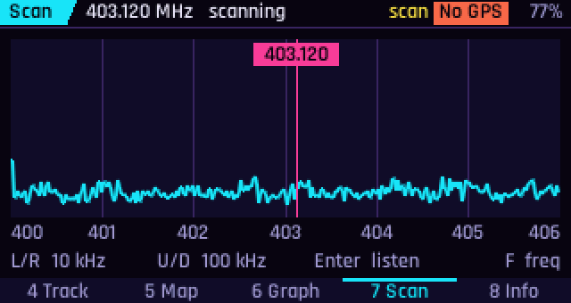
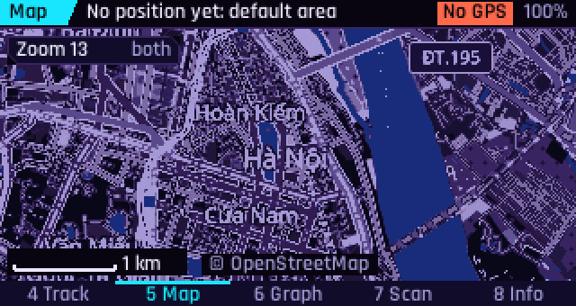

# SondeChase

**English** | [Tiếng Việt](README.vi.md)

RS41 radiosonde receiver, decoder and chase aid for the M5Stack CardputerZero
(Raspberry Pi CM0, 320×170 LCD, 46-key keyboard) with an RTL-SDR v4 and GPS.

Version 0.4.0. Runs on a real CardputerZero with an RTL-SDR Blog V4: scanning and decoding were checked on the
device with a live RS41 (Y0532351). GPS chasing in the field has not been tried yet; see "Test status".

| | |
|---|---|
|  |  |
| **Spectrum, tuned**: listening, Enter starts the decoder (a broadcast FM station here, to show a real signal) | **Spectrum, band overview** (`S`): a free cursor, Enter listens there |
|  |  |
| **Track**: sonde Y0532351 still waiting for its GPS fix | **Map**: OpenStreetMap tiles, recolored |
|  |  |
| **Hold `Esc`** to quit | **APPLaunch** launcher entry |

Screenshots are read from `/dev/fb0` of a running CardputerZero, shown at 2×. The spectrum captures were taken with
the RTL-SDR Blog V4 and no sonde in the air.

## Architecture

```
┌────────────┐          ┌────────────────────────────────────────────────────────────┐
│ RTL-SDR v4 │── USB ──►│ sdr.c  librtlsdr (dlopen) · USB thread · IQ ring           │
└────────────┘          └─────────┬─────────────────────────────────────┬────────────┘
                                  │ scan 2.048 MS/s                     │ decode 1.536 MS/s
                                  ▼                                     ▼
                    ┌────────────────────────────┐    ┌──────────────────────────────────┐
                    │ sweep: 4 steps             │    │ dsp.c DDC (rtl_fm -F9 chain)     │
                    │ 1024-pt FFT, peak hold     │    │ → 48 kHz cs16 + live FFT         │
                    └─────────────┬──────────────┘    └─────────────────┬────────────────┘
                                  │ spectrum                            │ stdin
                                  │                                     ▼
                                  │                         ┌────────────────────────┐
                                  │                         │ fsk_demod │ rs41mod    │
                                  │                         └───────────┬────────────┘
                                  │                                     │ JSON
                                  │                                     │
GPS ── gpsd, TCP 2947 ────────────┼─► position                          │
Magnetometer ── IIO sysfs ────────┼─► heading                           │
                                  │                                     │
                    ┌─────────────▼─────────────────────────────────────▼────────────────┐
                    │ sondechase  ·  C, LVGL 9.5, /dev/fb0 + evdev                       │
                    │ app.c   IDLE / SCAN / DECODE, tuning, known sondes                 │
                    │ geo.c   distance, bearing, ISA, landing prediction                 │
                    │ track.c history, burst, beeper → pacat → PipeWire                  │
                    │ ui.c    7 screens + alerts                                         │
                    └────────────────────────────────────────────────────────────────────┘
```

The app owns the dongle through `librtlsdr`, loaded at run time with `dlopen` (no build-time dependency, so the
cross build needs no librtlsdr in the sysroot). One USB thread fills a lock-free IQ ring; everything else runs in the
main loop. `fsk_demod` and `rs41mod` from `radiosonde_auto_rx` are the only external decoders; `radiosonde_auto_rx`
itself does not run.

The dongle is opened once and kept for the session; the scan sweep (2.048 MS/s) and the decoder (1.536 MS/s) take
turns on it, so switching job only restarts the USB stream at the other rate. `rtl_power` and `rtl_fm` are not used.
If `librtlsdr0` is missing or the dongle is busy, the reason shows on the status line and the app retries.

## Screens and keys

| Key | Function |
|---|---|
| `4` Track | HUD compass, distance, bearing, elevation, predicted landing point; sonde serial, frame and battery while its GPS has no fix |
| `5` Map | Tiles, device position, sonde, flight track, landing point. `Up/Down` zoom, `C` cycles follow mode (both / device / sonde), `V` simple / detailed map. With no position yet: centred on `map_lat` / `map_lon` |
| `6` Graph | `Left/Right` switch page: Skew-T log-P, altitude + vertical speed over time |
| `7` Radio | Spectrum, like an SDR app, with the tuned frequency's audio: `Left/Right` ±10 kHz, `Up/Down` ±100 kHz, `Enter` decode here. `S` band overview: the same keys move a cursor, `Enter` listens there. Holding an arrow key keeps tuning (after 0.4 s, 12 steps a second). `D` mode (NFM / AM / USB / LSB), `B` channel width |
| `8` Info | Sonde, reception, device, one pair of target coordinates |
| `F` | Enter frequency (kHz) |
| `M` | Mute / unmute beeper and radio audio |
| `R` / `X` | Restart decoder / stop |
| `Q`, or hold `Esc` 3 s | Quit (holding `Esc` shows a countdown) |

The burst alert overlays every screen: `Enter` opens Map, a short `Esc` dismisses.

**Spectrum**

- **Tuned view**: the tuned frequency stays in the middle and the screen shows the receiver's own samples ±384 kHz
  around it, refreshed 20 times a second. Its audio plays while the Radio screen is shown: NFM 16 kHz by default
  (the RS41's channel), with a noise squelch that turns an empty channel down to a murmur. `D` cycles NFM / AM / USB /
  LSB, `B` the mode's widths (NFM 16 / 25 / 6 / 12 kHz, AM 6 / 10 kHz, SSB 2.4 / 3 kHz); the mode and width show
  at the top left of the spectrum and a yellow bar under it marks the channel. The decoder always gets the full
  48 kHz stream, whatever is being listened to. Tuning only listens; `Enter` starts the decoder on
  that frequency (top bar: `listening` → `decoding`), and tuning away stops it until `Enter` again.
- **Band overview** (`S`, and at start-up when no `freq_hz` is set): 400–406 MHz swept continuously, about 4 passes a
  second with peak hold. Arrow keys move a cursor (same steps), `Enter` listens there, `X` stops.
- Every decoded frame records its frequency with the sonde serial; the spectrum labels that frequency with the serial
  (`Y0532351`).

**Missing hardware states**

- No SDR on USB (VID:PID `0bda:2838` or `0bda:2832`): a blocking "No SDR device found" screen.
  The app rechecks USB every 2 s and resumes decoding when the device appears. Disable the check: `sdr_check = 0`.
- No GPS fix on this device: sonde decoding is unaffected. The top bar shows `GPS lost` (had a fix before)
  or `No GPS`. The Track screen replaces distance, bearing and elevation with the absolute altitude and
  coordinates of the sonde and of the predicted landing point. Map follows the sonde. The beeper stays silent.
- Sonde without a GPS fix (still on the ground, `sats < 4`): its frames carry a meaningless position, so Track and
  Info show serial, frame, satellites and battery only, and nothing enters the track, history or prediction.

## Algorithms

**Scan sweep** (`app.c`, `io.c`): 4 retune steps at 2.048 MS/s keep the central 80 % of a 1024-point FFT (2 kHz bins).
After each retune the app drops 15 ms of settling plus one 16 KiB USB transfer, then averages 5 FFT frames.
The tuner's DC offset and LO leakage make false peaks within ~50 kHz of each tuning centre, so each step ignores that
zone and every other pass is shifted by half a step to measure it; the tuned view interpolates across it.
Each 5 kHz cell holds its value against the previous pass decayed by 3 dB, so a sonde's peak stays put between frames
and a signal that stops fades out within seconds.

**Decoder front end** (`dsp.c`, ported from `rtl_fm.c`, rtl-sdr 2.0.2): the same chain as
`rtl_fm -M raw -F9 -s 48000`. The dongle is tuned `f − 12 kHz + 384 kHz`, a 90° rotation brings the band to 0 Hz
(away from the DC spike), five binomial half-band stages decimate by 32 and a 9-tap FIR compensates the droop.
The 48 kHz cs16 stream goes to `fsk_demod | rs41mod` on stdin in `PIPE_BUF`-sized writes, which pipes deliver whole,
so a lagging decoder loses whole chunks (counted) and never sample alignment.

**Radio audio** (`radio.c`): the same 48 kHz stream, shifted by −12 kHz so the tuned frequency sits at 0 Hz, a 63-tap
channel filter (complex for USB / LSB, which keeps one side), the demodulator, and an average of 3 down to 16 kHz.
NFM: phase-difference discriminator; its squelch compares the discriminator's mean square over 20 ms with a threshold
per width, between ~0.05 rad² for a carrier with RS41 deviation and the noise level through that filter (0.13 to
1.39). AM: envelope around the carrier level, which also sets the gain. SSB: the real part, with an AGC. Broadcast
WFM (~200 kHz) does not fit in the 48 kHz stream. The audio is mixed under the beeper in the one `pacat` stream.

**Landing prediction** (`geo.c`, `predict_landing`)

- Descent rate under parachute at terminal velocity: `v(h) = v_sl · sqrt(ρ0 / ρ(h))`, `ρ(h)` from ISA.
- While the sonde descends, `v_sl` is calibrated from the measured vertical speed: `v_sl = |vv| / sqrt(ρ0 / ρ(h))`.
- While the sonde ascends: assumes burst altitude `burst_alt` and `descent_v0` from the config file.
- Horizontal drift integrated in 100 m layers: `Δx = w(h) · Δh / v(h)`. `w(h)` comes from the wind profile
  the sonde itself measured during ascent (250 m bins). Unobserved layers use the current horizontal velocity.

**Burst detection** (`track.c`, `flight_update`): vertical speed < −3 m/s for 3 consecutive frames,
altitude > 1000 m, after an ascent phase has been observed. If the app starts while the sonde is already
descending: the phase changes, no alert is raised.

**Proximity beeper** (`track.c`): horizontal distance from the device to the sonde (or to the last fix
after signal loss).

- On when d ≤ 10 km, off when d > 10.5 km.
- Period `T = 0.12 + 1.88 · (d / 10 km)^0.6` s; each beep 60 ms.
- Volume `V = 1 − 0.35 · log10(d / 100 m)`, clamped to 0.3–1.0.
- 2200 Hz while telemetry is updating, 1100 Hz after signal loss.
- Played through PipeWire with `pacat` (`audio_cmd`): PipeWire owns the ES8389 codec, so plain `aplay` cannot open it.

**Skew-T log-P** (`ui.c`): `y ∝ ln(1050 / p)` from 1050 to 100 hPa, isotherms skewed 45°,
dry adiabats `T = θ · (p/1000)^0.2857`. Dew point by Magnus (a = 17.62; b = 243.12 °C).
For RS41-SG (no pressure sensor), P is derived from altitude via ISA and shown with a `~` prefix.

## Map

The Map screen looks up each tile in this order:

1. Preloaded pack in `tile_dir` (PNGs already recolored to the UI palette, made with `tools/prep_tiles.py`).
2. Download cache in `~/.cache/sondechase/tiles` (original server PNGs; recolored when loaded into RAM).
3. If missing and `tile_online = 1`: fetch that tile over the network with `curl`, at most 2 concurrent
   connections. A failed tile is not retried for 30 s.

- Only visible tiles are fetched; the app never prefetches an area. This is the usage
  `tile.openstreetmap.org` allows; bulk downloading for offline use is forbidden.
- Every request sends a User-Agent identifying the app (`tile_user_agent`). The Map screen shows
  "© OpenStreetMap" when tiles are present.
- The cache is capped by `tile_cache_mb` (default 200 MB); when exceeded, the oldest tiles are deleted.
- Missing tiles show an empty grid with a status: `Loading map`, `No network: stored map only`,
  or `No map stored for this area` (when `tile_online = 0`).
- Recoloring (`tile_recolor` in `src/tiles.c`), two styles from the same OpenStreetMap tiles (`V` on the Map
  switches, `map_simple` sets the start-up one):
  - **simple** (default): only water and roads. Main roads (drawn in light red, orange and yellow by the OSM style)
    become bright, minor roads (white) dim; labels, buildings and landuse go to the background. Keyless simple
    styles (CARTO, Stamen, Thunderforest) now need an API key, so the app simplifies the standard tiles itself.
  - **detailed**: the most frequent color of a tile is treated as land background; output brightness is
    proportional to color distance from that background, so roads, labels and borders become bright strokes on a
    dark background; bluish pixels become water.
- `tools/prep_tiles.py` can still preload an area from an MBTiles file or a `z/x/y.png` directory that you are
  allowed to use offline. It does not download tiles.

## Build and packaging

Install layout and `.deb` packaging follow the CardputerZero Template contract (`cmake/cm0-package.cmake`,
`cmake/toolchains/cp0-aarch64-linux-gnu.cmake`, same preset names as the Template):

```sh
# Build on the device itself (Debian 13; needs cmake, ninja-build, build-essential). ~10 min the first time.
cmake --workflow --preset cp0-native-package
# -> dist/sondechase_0.4.0-rev1_arm64.deb

# Or cross build on a Debian/Ubuntu PC (needs crossbuild-essential-arm64, ninja-build, cmake >= 3.25).
# The first run downloads the CardputerZero BSP sysroot and LVGL v9.5.0.
cmake --workflow --preset cp0-cross-package

# Install on the CardputerZero:
sudo apt install --no-install-recommends ./sondechase_0.4.0-rev1_arm64.deb
```

Package contents:

| Path | Contents |
|---|---|
| `/usr/bin/sondechase` | binary (LVGL, PNG and TTF decoders statically linked) |
| `/etc/sondechase.conf` | configuration (conffile) |
| `/usr/share/sondechase/fonts/` | Rajdhani SemiBold, Orbitron Bold |
| `/usr/share/sondechase/tiles/` | directory for a preloaded map pack (empty) |
| `/usr/share/APPLaunch/applications/sondechase.desktop` | launcher entry |
| `/usr/share/APPLaunch/share/images/sondechase.png` | 100×100 icon |
| `/usr/lib/sondechase/fsk_demod`, `/usr/lib/sondechase/rs41mod` | decoders, built from `radiosonde_auto_rx` v1.9.0 sources during the build |

`Depends: libc6, curl, librtlsdr0 (>= 2.0.2)` (Debian 13's librtlsdr0 drives the RTL-SDR Blog V4; it is loaded at
run time, not linked). The build downloads the `radiosonde_auto_rx` v1.9.0 release tarball (SHA-256 pinned) and
compiles `fsk_demod` and `rs41mod` with the flags of its Makefiles; their licenses go to `/usr/share/doc/sondechase/`.
Optional at run time: `gpsd` for this device's position, `pacat` (`pulseaudio-utils`) for the beeper (both in
`Recommends`).

The package installs no systemd service: the app is opened from APPLaunch and runs as the launcher's user.
That user needs read/write access to `/dev/fb0`, `/dev/input/event*`, the RTL-SDR and PipeWire (groups
`video`, `input`, `plugdev`, `audio`). The app is a child subreaper: decoder, audio and tile pipelines it stops are
collected by the app itself instead of being left as zombies under the launcher.

`app-builder.json` is the manifest for `czdev publish`; the Template's check script
(`validate_app_builder.cmake`) accepts it.

### Demo mode and rendered screenshots

- `demo = 1` in the config file: the app plays a simulated flight (ascent at 5 m/s to 31.2 km, burst, parachute
  descent, landing, signal loss after 90 s) through the same processing path as real frames. No SDR, GPS or
  decoder needed. `demo_speed` is simulated seconds per real second.
- `tools/render.c` runs the real UI code on an in-memory display and writes a 320×170 image of each screen:

```sh
cmake -S . -B build-render -DSC_RENDER=ON && cmake --build build-render -j
./build-render/sc_render <output dir> assets/fonts <tile dir>     # writes .ppm files
```

The images directly in `screenshots/` (used by `app-builder.json`) come from this tool with demo data; the map
background there is synthetic. `screenshots/device/` holds the framebuffer captures from the real device shown above.

PC build for interacting with the UI: `cmake -S . -B build-sim -DSC_SIM=ON` (needs `libsdl2-dev`; untested).
Core only, with tests: `cmake -S . -B build -DSC_BUILD_UI=OFF && cmake --build build && ctest --test-dir build`.

### Tile sources

`prep_tiles.py` does not download tiles. Its input is an existing raster MBTiles file or `z/x/y.png` directory:
tiles you rendered yourself from OSM data, or a provider's tile pack licensed for offline use.
The `tile.openstreetmap.org` server does not allow bulk downloading for offline use.
The `--recolor dark` filter converts light tiles to the UI's dark palette with a heuristic based on color
distance from the dominant background color; it needs tuning if the tile style differs much from standard OSM.

## Test status

`tests/test_core.c`: 4247 checks pass on Debian 13 arm64 (`-Wall -Wextra -Werror`). A fake `librtlsdr`
(`tests/fake_rtlsdr.c`, a 403.000 MHz carrier wherever it is tuned) runs scanning and decoding end to end without a
dongle. Covered: geodesy, ISA,
dew point, landing prediction, rs41mod JSON (including a real no-fix frame) and gpsd parsers, heading, spectrum
cells and peak hold, IQ ring, FFT, decoder front end (sonde lands at +12 kHz, images ≥ 20 dB down, chunking
bit-exact), radio audio (NFM / AM / USB / LSB recover their test tone, NFM squelches noise), listen → decode switching, held-key repeat, stdin feeding, process-group reaping, flight history, tiles, child pipeline lifecycle.

On a CardputerZero (Debian 13, RTL-SDR Blog V4, sonde Y0532351 at 403.000 MHz):

| Check | Result |
|---|---|
| Decode, 60 s | 55 frames (first after 4.2 s, then 1/s); `rtl_fm` pipeline: 58 |
| CPU while decoding | 15.6 % of one core for the whole app (`rtl_fm` alone used 61.5 %) |
| Scan | full 400–406 MHz pass every ~0.25 s, 12.8 % CPU, sonde at +55 dB |
| Dropped samples | 0 in the IQ ring, 0 in the decoder pipe |
| Retune (R828D, I2C) | 32.7 ms; scan → decode switch 621 ms when the dongle was reopened (it now stays open; not re-measured on hardware) |
| Listening (spectrum + FM audio, no decoder) | 22.6 % of one core; a broadcast FM station at 100.0 MHz is heard, an empty 403 MHz channel squelched to a murmur |
| Display, keyboard, PipeWire audio, magnetometer node, OSM tile download | working |

Not yet checked: GPS (no module fitted yet), the proximity beeper in the field, burst detection and landing
prediction on a real flight, the `cp0-cross` cross build, drawing speed with many map tiles.

## Known limitations

- RS41 only. Other sonde types need their own decoder and `fsk_demod` parameters.
- Next to a very strong sonde the overview can show weaker spurs (402.88 and 404.6 MHz were seen with the sonde
  a few cm from the antenna); tuning to them shows nothing to decode.
- Compass not calibrated: the magnetometer has a large hard-iron offset on this board; `mag_off_x/y`,
  `mag_rot_deg`, `mag_flip_y` must be set by hand, and there is no tilt compensation yet.
- Skew-T stops at 100 hPa; moist adiabats and mixing ratio lines are not drawn yet.
- Landing prediction during ascent depends on the assumed `burst_alt` and has no wind above the current altitude.
- Flight history keeps 2048 samples (5 s/sample, downsampled automatically when full); not restored after an app
  restart. The full CSV log is written to `~/sondechase.csv`.

## License

SondeChase is released under the GNU General Public License, version 3 or (at your option) any later version (`GPL-3.0-or-later`), see [`LICENSE`](LICENSE).
This license allows bundling the upstream decoders in the repository or install package.

Third-party components:

| Component | License |
|---|---|
| `rs41mod` (zilog80, [rs1729/RS](https://github.com/rs1729/RS), via [radiosonde_auto_rx](https://github.com/projecthorus/radiosonde_auto_rx)) | GPL-3.0 |
| `fsk_demod` ([codec2](https://github.com/drowe67/codec2), David Rowe) | LGPL-2.1 |
| Decoder front end in `src/dsp.c`, ported from `rtl_fm.c` ([rtl-sdr](https://gitea.osmocom.org/sdr/rtl-sdr)) | GPL-2.0-or-later |
| `librtlsdr` (loaded at run time) | GPL-2.0-or-later |
| [LVGL](https://github.com/lvgl/lvgl) v9.5 | MIT |
| Files in `cmake/` taken from the CardputerZero Template | MIT, see `cmake/LICENSE-CardputerZero-Template.txt` |
| Rajdhani, Orbitron fonts | SIL OFL 1.1, see `assets/fonts/OFL-*.txt` |
| Map data | © OpenStreetMap contributors, ODbL |
