# SondeChase

**English** | [Tiếng Việt](README.vi.md)

[](https://github.com/hieuha/CardputerZero-Sondechase/actions/workflows/tests.yml)
[](https://github.com/hieuha/CardputerZero-Sondechase/actions/workflows/package.yml)
[](https://github.com/hieuha/CardputerZero-Sondechase/actions/workflows/validate.yml)
[](https://github.com/hieuha/CardputerZero-Sondechase/releases/latest)
[](LICENSE)
[](https://docs.m5stack.com/)
[](https://lvgl.io)

> **New here? See the [keyboard cheatsheet](docs/keyboard-cheatsheet.md)** for every key on every screen.

RS41 radiosonde receiver, decoder and chase aid for the M5Stack CardputerZero (Raspberry Pi CM0, 320×170 LCD,
46-key keyboard), with an RTL-SDR (or a HackRF) and an optional GPS.

Version 0.8.0. Tested on a real CardputerZero with an RTL-SDR Blog V4: scanning and decoding were checked with live
RS41s (Y0532351, Y0310371), and the GPS on a LoRa-1262 cap got a 3D fix outdoors (15 satellites used). Chasing a sonde
in the field has not been tried yet; see [Known limitations](#known-limitations).

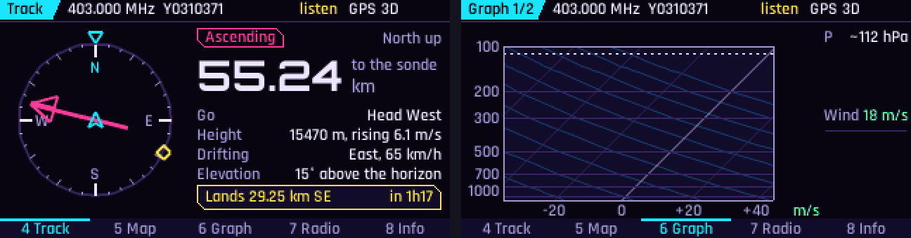

*A real flight replayed through the app's screens: sonde Y0310371, launched from Hanoi on 2026-11-20 and received on
403.000 MHz from 15 km up to 30 km. Track (left) shows the distance, the elevation and the landing estimate; the
Skew-T (right) draws temperature and dew point as the balloon climbs. Made from the flight log by the render tool.*

| | |
|---|---|
| 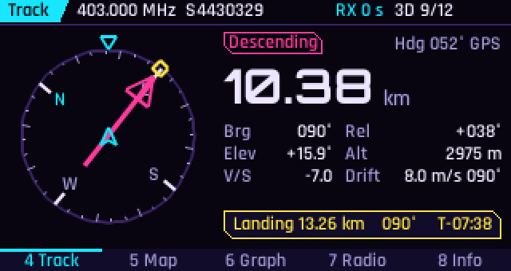 | 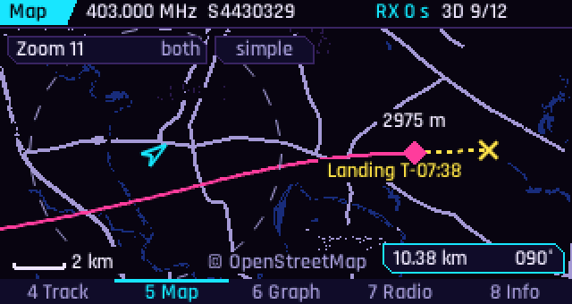 |
| **Track**: distance to the sonde and which way to go, in plain words; landing prediction | **Map**: simple style (water and roads), flight track, landing point |
| 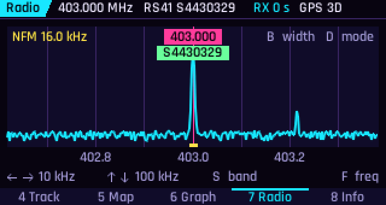 | 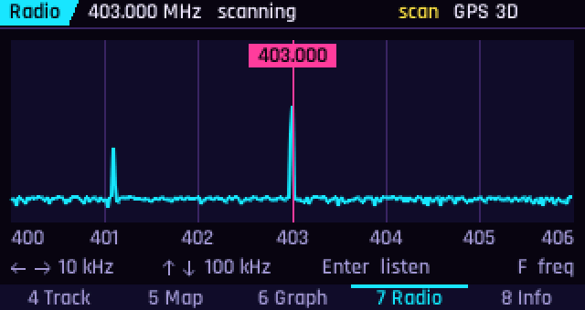 |
| **Radio**: tuned spectrum, NFM audio, `Enter` decodes | **Radio, Scan** (`S`): finds the peaks and tries each on the decoder; arrow keys pick by hand |
| 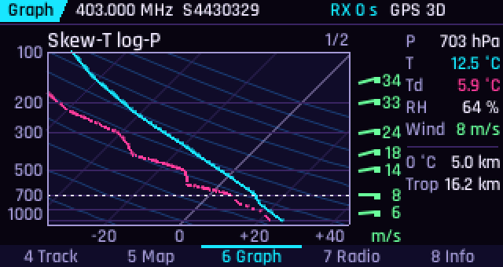 | 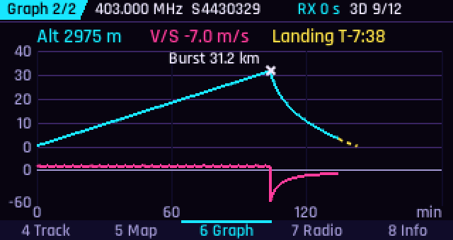 |
| **Graph**: Skew-T log-P of the sounding | **Graph**: altitude and vertical speed, burst marked |
| 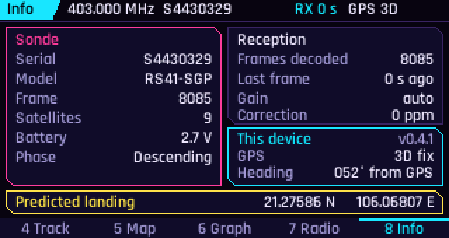 | 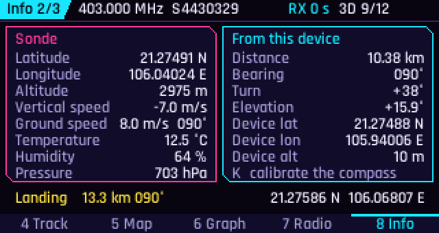 |
| **Info 1/2**: sonde, reception, this device, landing coordinates | **Info 2/2** (`→`): exact coordinates, bearing, elevation, speeds, weather; `K` calibrates the compass |
| 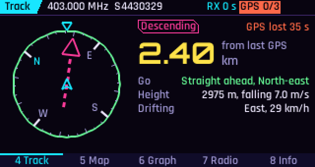 | 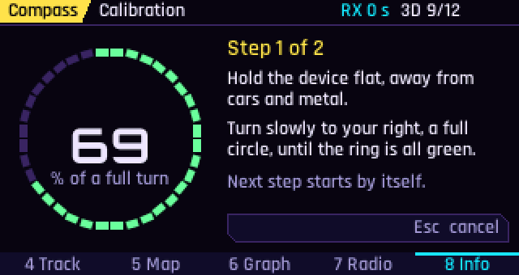 |
| **Track, GPS lost**: distance and direction from the device's last fix, in yellow | **Compass calibration** (Info, `K`): turn a full circle, lean four ways, then point north |
| 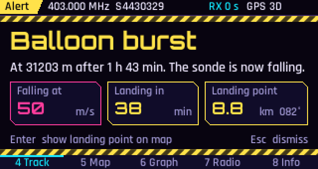 | 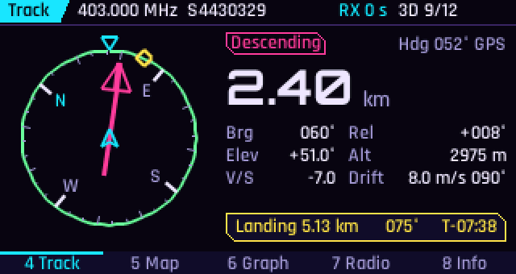 |
| **Burst alert**: falling speed, time and distance to landing | **Track, on course**: ring and `Go` turn green within 15° |

These are mockups: the app's own UI code (`tools/render.c`) drawing a simulated flight, the radio spectrum made up,
the map from OpenStreetMap tiles. Shown at 2×.

On the device (framebuffer captures, 2×):

| | |
|---|---|
| 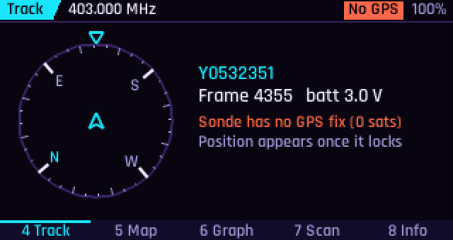 | 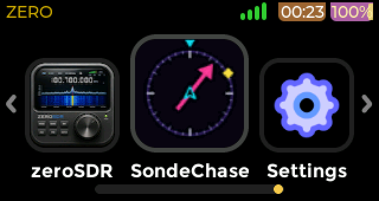 |
| **Track**: a real RS41 (Y0532351) still waiting for its GPS fix | **APPLaunch** launcher entry |
| 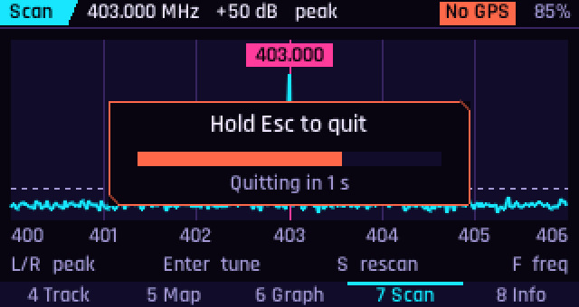 | 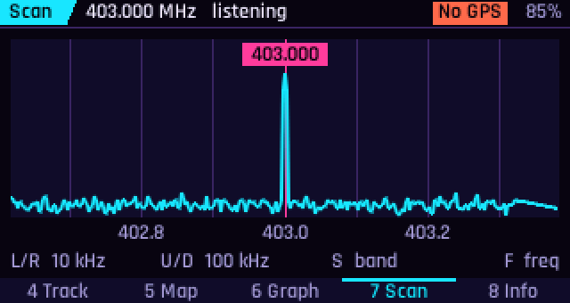 |
| **Hold `Esc`** to quit | **Radio** with a real RTL-SDR Blog V4, on a broadcast FM station (no sonde in the air) |

## Hardware

| Part | Notes |
|---|---|
| M5Stack CardputerZero | Raspberry Pi CM0, Debian 13 arm64, 320×170 LCD, 46-key keyboard, PipeWire audio |
| RTL-SDR | Tested: RTL-SDR Blog V4 (R828D tuner). Other RTL2832U dongles are not tested |
| HackRF (experimental) | HackRF One or rad1o, picked up from USB; the package installs `libhackrf0`. Scan and WFM audio work; in the one live test it did not receive the sonde an RTL-SDR V4 decoded ([issue #1](https://github.com/hieuha/CardputerZero-Sondechase/issues/1)). Use an RTL-SDR to chase |
| GPS (optional) | Any receiver that gpsd reads: a USB GPS, or the GPS on a cap such as the LoRa-1262 cap (see [GPS](#gps)). Needed for distance, bearing, landing and the beeper |
| Magnetometer (optional) | IIO magnetometer on the board, used for heading when there is no GPS course |
| ACT LED | The red LED blinks on each frame on the Track and Map screens |

Without GPS the sonde is still decoded and its telemetry shown; the beeper stays silent.

### GPS

Plug it in; there is nothing to set up.

- **USB GPS**: gpsd picks it up, also while the app runs.
- **GPS on a cap** (tried with the LoRa-1262 cap; its GPS is on `/dev/ttyS0`): the EXT header's 5 V is off at boot,
  so the app switches it on when it opens and reads the GPS itself (115200 or 9600 baud, found by itself). When the
  app quits, the 5 V goes back off (it is left on if it was already on).
- With both, the USB GPS (through gpsd) is used.
- Connect the cap's GPS antenna. Without it the GPS sees no satellites and the top bar stays at `GPS 0/0`.

Details and checks: [deployment guide](docs/deployment-guide.md#gps).

## Install

Download `sondechase_0.8.0-rev1_arm64.deb` from the [latest release](https://github.com/hieuha/CardputerZero-Sondechase/releases/latest),
copy it to the device, and install it:

```sh
sudo apt install --no-install-recommends ./sondechase_0.8.0-rev1_arm64.deb
```

Open **SondeChase** from APPLaunch. The package includes the RS41 decoders (`fsk_demod` and `rs41mod`, from
`radiosonde_auto_rx`). It needs `librtlsdr0`, `libhackrf0` and `curl`; `gpsd` and `pulseaudio-utils` are recommended.

To build the package yourself (on the device or cross-compiled), see [deployment guide](docs/deployment-guide.md).

## Keys

| Key | Function |
|---|---|
| `4` Track | HUD compass and the distance to the sonde, with which way to go in words (`Bear right, East`, `Straight ahead`), its height and drift, the elevation to point an antenna at (`Elevation 37° above the horizon`, hidden once it has landed), and the predicted landing point with the time left (`in 7:38`, from an hour `in 1h52`). The ring and the `Go` line turn green while the arrow is within 15° of straight ahead. If GPS drops out, distance and direction come from the device's last fix (yellow, `from last GPS`). Sonde without a GPS fix: serial, frame and battery. Each frame ticks and blinks the red LED |
| `5` Map | Tiles, device position, sonde, flight track, landing point. Arrow keys pan (hold to keep moving; the map stops following, `free`). `Sym` + `T` (`+`) zooms in, `Sym` + `R` (`-`) zooms out. `C` cycles both / device / sonde, or follows again after panning. `V` switches simple / detailed style. With no position yet: centred on `map_lat` / `map_lon` |
| `6` Graph | `Left` / `Right` switch page: Skew-T log-P, altitude and vertical speed over time |
| `7` Radio | Spectrum with the tuned frequency's audio. `Left` / `Right` ±10 kHz, `Up` / `Down` ±100 kHz (hold to keep tuning). `Enter` decodes here. `S` Scan, `Esc` goes back. `D` mode (NFM / AM / USB / LSB / WFM), `B` channel width |
| `8` Info | `K` calibrates the compass (turn a full circle to the right, lean the device forward, back, left and right, then point north and press `Enter`; saved to `<data_dir>/compass.conf`). `Left` / `Right` switch page: 1/2 sonde, reception, device, landing point; 2/2 exact numbers (coordinates, bearing, turn and elevation angles, speeds, temperature, humidity, pressure, device position) |
| `Tab` | Next screen (Track → Map → Graph → Radio → Info → Track) |
| `F` | Enter a frequency in kHz; `Enter` tunes it (within the tuner's range) and decodes |
| `S` | Scan 400–406 MHz and try the peaks on the decoder (see [Radio screen](#radio-screen)) |
| `X` | Stop the receiver |
| `R` | Restart the decoder on the current frequency |
| `M` | Mute / unmute the beeper, frame tick and radio audio (the LED still blinks) |
| Hold `Esc` for 3 s | Quit (shows a countdown; a short `Esc` or a stray key never quits) |

The burst alert overlays every screen: `Enter` opens Map, a short `Esc` dismisses it.

## Screens

| Screen | Shows |
|---|---|
| Track | Compass ring, arrow to the sonde, distance, which way to go, height, drift, elevation, landing point; top bar with the frequency, state and GPS |
| Map | OpenStreetMap tiles (downloaded on demand), device, sonde, track, landing point |
| Graph | Skew-T log-P (`Graph 1/2`) and altitude / vertical speed with the burst marked (`Graph 2/2`) |
| Radio | Live spectrum of the receiver's band around the tuned frequency, shaded channel width, decode status |
| Info | Page 1: sonde ID, frame count, battery, GPS and reception details. Page 2: coordinates, bearing, elevation, speeds, temperature, humidity, pressure. The page number is in the top-left label (`Info 1/2`) |

### Radio screen

- At start-up without `freq_hz`, SondeChase listens mid-band (403.000 MHz) and plays the audio. Tuning only listens.
  `Enter` starts the decoder on that frequency; the top bar shows `listen` or `decode`.
- **Scan** (`S`): sweeps 400–406 MHz continuously. After two passes it tries the strongest peak on the decoder for
  10 s. An RS41 frame ends the scan there (`found RS41 …`). Otherwise that peak is left alone for 2 min and the sweep
  continues. Arrow keys take over the choice; `Enter` tunes the cursor (while a peak is being tried, the arrows tune
  from that peak instead); `Esc` goes back to the previous frequency.
- Decoded frames record their frequency; the spectrum labels it with the sonde serial.

### Without the receiver or GPS

- **No SDR on USB**: a "No SDR device found" screen. The app checks USB every 2 s and resumes when an RTL-SDR or a
  HackRF appears.
  Disable the check with `sdr_check = 0`.
- **No GPS fix**: decoding continues. The top bar shows `GPS 0/3` in red while the receiver is plugged in without a
  fix (satellites used / in view), `GPS lost` after a fix, or `No GPS`. With a fix it shows `3D 9/12`. Once the device
  has had a fix, Track keeps showing the distance and direction, measured from that last device position.
- **Sonde without a GPS fix** (still on the ground): its position is not used; Track and Info show serial, frame,
  satellites and battery.

## Quick configuration

The config file is `/etc/sondechase.conf`. Lines are `key = value`; `#` starts a comment, at the start of a line or
after a space. Every key is optional.

```ini
freq_hz = 403000000      # decode at start-up (unset: open on the Radio screen)
gain = 38.6              # RTL-SDR tuner gain in dB (unset: tuner AGC)
sdr = auto               # receiver: auto (from USB), rtlsdr or hackrf
sdr_check = 1            # require a receiver on USB
gpsd_port = 2947         # gpsd (0 turns it off)
gps_serial = /dev/ttyS0  # GPS cap read by the app (empty turns it off)
burst_alt = 30000        # assumed burst altitude while ascending, m
tile_online = 1          # download the map tiles that are on screen
tile_cache_mb = 1000     # tile cache size limit, MB (viewed tiles stay for offline use)
map_simple = 1           # simple map style (V toggles it on the Map)
demo = 0                 # 1 = simulated flight, no hardware needed
```

The LCD is found by itself (`/dev/fb_lcd`, else `/proc/fb`), so it keeps working when HDMI is attached. Set
`fb_dev` only to force another framebuffer.

Full key reference, defaults, packaging and map tile packs: [deployment guide](docs/deployment-guide.md#configuration).

Demo mode (`demo = 1`) plays a simulated flight through the same code path, which is useful to see every screen
without a dongle.

## Data and map cache

Everything the app keeps is in one folder, `data_dir` (default `~/sondechase`):

```
~/sondechase/
├── sondechase.csv   # every valid sonde frame, appended across sessions
├── log/             # one radiosonde_auto_rx-format log per sonde
└── tiles/           # map tiles downloaded so far (offline map)
```

- `log/YYYYMMDD-HHMMSS_<serial>_RS41_<MHz>_sonde.log`: times are UTC from the sonde's own GPS time, so they are right
  in the field with no network. SNR and frequency error are written as `-1`.
- `tiles/`: every tile the Map has shown is kept, and is used before the network, so an area seen once works offline.
  Before a chase, look over the area at the zoom levels you need while on Wi-Fi. The cache keeps up to
  `tile_cache_mb` (1000 MB) and then drops the oldest tiles.
- Files from before 0.5.1 (`~/sondechase.csv`, `~/.cache/sondechase/tiles`) are moved in on the first start.

## Documentation

| Document | Contents |
|---|---|
| [Keyboard cheatsheet](docs/keyboard-cheatsheet.md) | Every key, screen by screen |
| [Project overview and PDR](docs/project-overview-pdr.md) | Scope, requirements, acceptance criteria |
| [System architecture](docs/system-architecture.md) | Modules, data flow, peripherals, algorithms (DSP, demodulation, landing prediction, burst, beeper), map and tiles |
| [Code standards](docs/code-standards.md) | C conventions, naming, tests, commits |
| [Codebase summary](docs/codebase-summary.md) | Files and their roles |
| [Deployment guide](docs/deployment-guide.md) | Builds, tests, install, configuration reference, release steps, device checks |
| [Project roadmap](docs/project-roadmap.md) | Released versions, known gaps |
| [Publish record](PUBLISH.md) | What goes to the CardputerZero store: package, listing, assets, last submission |

## Test status

`tests/test_core.c`: 4496 checks, 0 failed on Debian 13 (GCC 14.2). CI runs the core tests on Ubuntu and the native
arm64 package build on Debian 13. A fake `librtlsdr`, a fake `libhackrf` and a fake decoder run scanning and decoding
end to end without a dongle. Details and the device measurements: [deployment guide](docs/deployment-guide.md#tests).

## Known limitations

- RS41 only. Other sonde types need their own decoder.
- HackRF support is experimental: no RS41 has been received with it yet ([issue #1](https://github.com/hieuha/CardputerZero-Sondechase/issues/1)). It has no AGC; set the
  gain with `hackrf_gain = LNA,VGA,amp` (default 32,24,0).
- Next to a very strong sonde the overview can show weaker spurs; tuning to them shows nothing to decode.
- The compass must be calibrated once (Info, `K`: turn a full circle, lean four ways, then point north). After that
  it is tilt-compensated with the accelerometer, so the device need not be held flat (not within about 14° of
  pointing straight up or down). Until then, trust the heading only while moving faster than about 5.4 km/h
  (1.5 m/s, `cog_min_speed`), where it is the GPS course.
- Skew-T reaches 100 hPa, or 10 hPa (about 31 km) once the flight has been above 100 hPa; moist adiabats and
  mixing-ratio lines are not drawn.
- Landing prediction during ascent depends on the assumed `burst_alt`.
- Flight history is not restored after an app restart.
- Not yet checked in the field: chasing with GPS, the beeper, burst detection and landing on a real flight. Full list in the
  [roadmap](docs/project-roadmap.md#known-gaps).

## License

SondeChase is released under the GNU General Public License, version 3 or (at your option) any later version
(`GPL-3.0-or-later`), see [`LICENSE`](LICENSE).

Third-party components:

| Component | License |
|---|---|
| `rs41mod` (zilog80, [rs1729/RS](https://github.com/rs1729/RS), via [radiosonde_auto_rx](https://github.com/projecthorus/radiosonde_auto_rx)) | GPL-3.0 |
| `fsk_demod` ([codec2](https://github.com/drowe67/codec2), David Rowe) | LGPL-2.1 |
| Decoder front end in `src/dsp.c`, ported from `rtl_fm.c` ([rtl-sdr](https://gitea.osmocom.org/sdr/rtl-sdr)) | GPL-2.0-or-later |
| `librtlsdr` (loaded at run time) | GPL-2.0-or-later |
| `libhackrf` (loaded at run time) | GPL-2.0-or-later |
| [LVGL](https://github.com/lvgl/lvgl) v9.5 | MIT |
| Files in `cmake/` taken from the CardputerZero Template | MIT, see `cmake/LICENSE-CardputerZero-Template.txt` |
| Rajdhani, Orbitron fonts | SIL OFL 1.1, see `assets/fonts/OFL-*.txt` |
| Map data | © OpenStreetMap contributors, ODbL |
