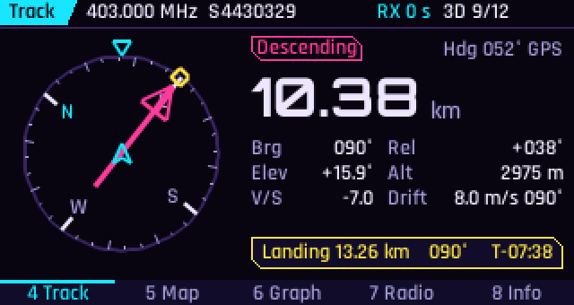
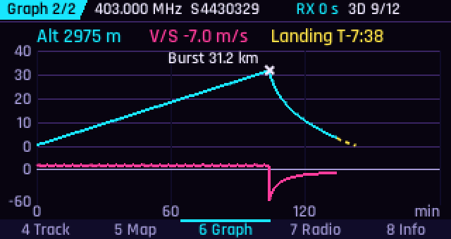
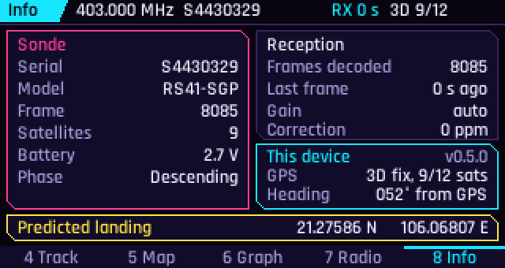
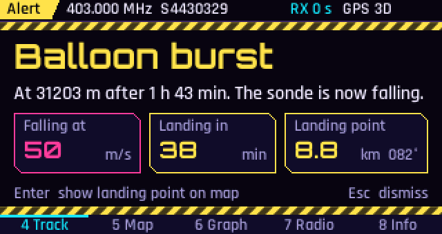
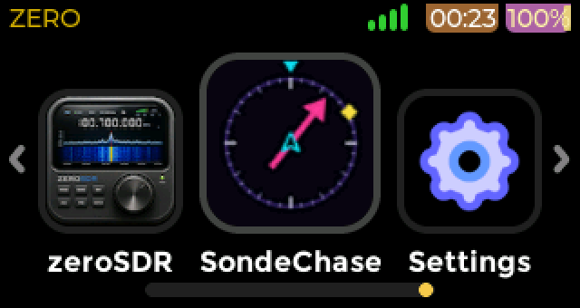
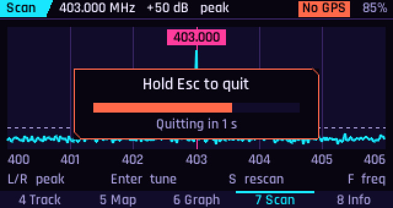
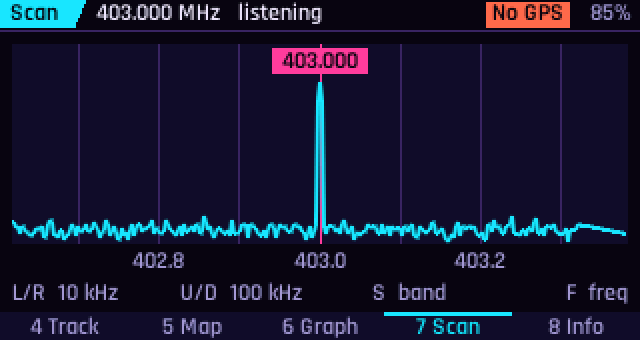

# SondeChase

[English](README.md) | **Tiếng Việt**

[](https://github.com/hieuha/CardputerZero-Sondechase/actions/workflows/tests.yml)
[](https://github.com/hieuha/CardputerZero-Sondechase/actions/workflows/package.yml)
[](https://github.com/hieuha/CardputerZero-Sondechase/actions/workflows/validate.yml)
[](https://github.com/hieuha/CardputerZero-Sondechase/releases/latest)
[](LICENSE)
[](https://docs.m5stack.com/)
[](https://lvgl.io)

Ứng dụng thu, giải mã radiosonde RS41 và hỗ trợ chase trên M5Stack CardputerZero
(Raspberry Pi CM0, LCD 320×170, bàn phím 46 phím) với RTL-SDR v4 và GPS.

Phiên bản 0.5.0. Đã chạy trên CardputerZero thật với RTL-SDR Blog V4: phần quét và giải mã đã được kiểm trên máy
với một sonde RS41 đang phát (Y0532351). Chưa thử chase ngoài thực địa có GPS; xem mục "Trạng thái kiểm thử".

| | |
|---|---|
|  |  |
| **Track**: khoảng cách, hướng, góc ngẩng tới sonde, dự đoán điểm rơi | **Map**: kiểu simple (nước và đường), vệt bay, điểm rơi |
|  |  |
| **Radio**: phổ đang thu, audio NFM, `Enter` để giải mã | **Radio, Scan** (`S`): tự tìm đỉnh sóng và thử giải mã từng đỉnh; phím mũi tên để chọn tay |
|  |  |
| **Graph**: Skew-T log-P của chuyến thám không | **Graph**: độ cao và tốc độ đứng, có đánh dấu điểm nổ |
|  |  |
| **Info**: sonde, thu nhận, thiết bị, tọa độ điểm rơi | **Cảnh báo nổ**: tốc độ rơi, thời gian và khoảng cách tới điểm rơi |

Đây là ảnh mockup: chính mã UI của app (`tools/render.c`) vẽ một chuyến bay mô phỏng, phổ radio là dữ liệu dựng, bản
đồ từ tile OpenStreetMap. Phóng 2×.

Trên máy thật (chụp framebuffer, phóng 2×):

| | |
|---|---|
|  |  |
| **Track**: một sonde RS41 thật (Y0532351) đang chờ GPS fix | Mục trong launcher **APPLaunch** |
|  |  |
| **Giữ `Esc`** để thoát | **Radio** với RTL-SDR Blog V4 thật, đang nghe một đài FM phát thanh (lúc không có sonde) |

## Kiến trúc

```
┌────────────┐          ┌────────────────────────────────────────────────────────────┐
│ RTL-SDR v4 │── USB ──►│ sdr.c  librtlsdr (dlopen) · luồng USB · ring IQ            │
└────────────┘          └─────────┬─────────────────────────────────────┬────────────┘
                                  │ quét 2,048 MS/s                     │ nghe / giải mã 1,536 MS/s
                                  ▼                                     ▼
                    ┌────────────────────────────┐    ┌──────────────────────────────────┐
                    │ quét: 4 bước               │    │ dsp.c DDC (chuỗi rtl_fm -F9)     │
                    │ FFT 1024 điểm, giữ đỉnh    │    │ → cs16 48 kHz + FFT trực tiếp    │
                    └─────────────┬──────────────┘    └───────────────┬─────────┬────────┘
                                  │ phổ                               │ stdin   │
                                  │                                   ▼         └─► radio.c NFM/AM/SSB/WFM audio → pacat
                                  │                         ┌────────────────────────┐
                                  │                         │ fsk_demod │ rs41mod    │
                                  │                         └───────────┬────────────┘
                                  │                                     │ JSON
                                  │                                     │
GPS ── gpsd, TCP 2947 ────────────┼─► vị trí                            │
Từ kế ── IIO sysfs ───────────────┼─► hướng                             │
                                  │                                     │
                    ┌─────────────▼─────────────────────────────────────▼────────────────┐
                    │ sondechase  ·  C, LVGL 9.5, /dev/fb0 + evdev                       │
                    │ app.c   IDLE / SCAN / LISTEN / DECODE, dò tần, sonde đã biết       │
                    │ geo.c   khoảng cách, hướng, ISA, dự đoán điểm rơi                  │
                    │ track.c lịch sử, bóng nổ, beeper + audio radio → pacat → PipeWire  │
                    │ ui.c    Track, Map, Graph, Radio, Info + cảnh báo                  │
                    └────────────────────────────────────────────────────────────────────┘
```

App tự giữ dongle qua `librtlsdr`, nạp lúc chạy bằng `dlopen` (không phụ thuộc lúc build, nên cross build không cần
librtlsdr trong sysroot). Một luồng USB đổ IQ vào ring không khóa; mọi phần khác chạy trong vòng lặp chính.
`fsk_demod` và `rs41mod` của `radiosonde_auto_rx` là hai decoder ngoài duy nhất; bản thân `radiosonde_auto_rx`
không chạy.

Dongle được mở một lần và giữ suốt phiên; việc quét dải (2,048 MS/s) và bộ thu đang dò (1,536 MS/s, nghe và giải
mã) lần lượt dùng nó, nên
đổi việc chỉ cần chạy lại luồng USB ở tốc độ mẫu kia. App không dùng `rtl_power` và `rtl_fm`. Nếu thiếu `librtlsdr0`
hoặc dongle đang bị chương trình khác giữ, lý do hiện trên dòng trạng thái và app tự thử lại.

## Màn hình và phím

| Phím | Chức năng |
|---|---|
| `4` Track | La bàn HUD, khoảng cách, bearing, elevation, điểm rơi dự đoán; số hiệu, frame và pin của sonde khi GPS của nó chưa fix. Mỗi frame nhận được kêu một tiếng tít và nháy đèn đỏ. Vòng la bàn chuyển xanh khi mũi tên lệch không quá 15° so với hướng đang đi |
| `5` Map | Tile, vị trí máy, sonde, vệt bay, điểm rơi. Phím mũi tên để pan (giữ phím thì chạy liên tục; bản đồ thôi bám, hiện `free`), `+` / `-` để zoom, `C` bám lại như trước khi pan, còn lại thì đổi both / device / sonde, `V` đổi bản đồ đơn giản / chi tiết. Khi chưa có vị trí nào: căn giữa theo `map_lat` / `map_lon` |
| `6` Graph | `Left/Right` đổi trang: Skew-T log-P, độ cao + tốc độ đứng theo thời gian |
| `7` Radio | Phổ kiểu app SDR, kèm audio của tần số đang thu: `Left/Right` ±10 kHz, `Up/Down` ±100 kHz, `Enter` để giải mã tại đó. `S` Scan: quét dải và thử giải mã từng đỉnh sóng cho tới khi gặp RS41 (xem bên dưới); `Esc` để quay lại. Giữ phím mũi tên thì tần số tự chạy (sau 0,4 s, 12 bước mỗi giây). `D` đổi kiểu điều chế (NFM / AM / USB / LSB / WFM cho đài phát thanh FM), `B` đổi độ rộng kênh, hiện bằng dải tô màu quanh tần số đang thu |
| `8` Info | Sonde, thu nhận, thiết bị, một cặp tọa độ đích |
| `Tab` | Sang màn kế tiếp (Track → Map → Graph → Radio → Info → Track) |
| `F` | Nhập tần số (kHz) |
| `M` | Tắt / bật tiếng beeper, tiếng tít mỗi frame và audio radio (đèn vẫn nháy) |
| `R` / `X` | Khởi động lại decoder / dừng |
| `Q`, hoặc giữ `Esc` 3 s | Thoát (giữ `Esc` sẽ hiện đếm ngược) |

Cảnh báo bóng nổ hiện đè lên mọi màn hình: `Enter` mở Map, bấm `Esc` ngắn để đóng.

**Màn Radio**

- **Đang thu** (lúc mở app khi chưa đặt `freq_hz`: nghe ở giữa dải, 403,000 MHz): tần số đang thu nằm giữa màn, màn hình hiện chính mẫu của bộ thu ±384 kHz quanh nó, cập nhật 20 lần/s.
  Audio của tần số đó phát khi đang ở màn Radio: mặc định NFM 16 kHz (đúng kênh của RS41), có squelch theo mức nhiễu nên
  kênh trống chỉ còn tiếng rì nhỏ. `D` đổi NFM / AM / USB / LSB / WFM, `B` đổi độ rộng của chế độ đó (NFM 16 / 25 / 6 / 12 kHz,
  AM 6 / 10 kHz, SSB 2,4 / 3 kHz, WFM 180 kHz); chế độ và độ rộng hiện ở góc trên bên trái phổ, một dải tô màu rộng
  đúng bằng kênh đánh dấu kênh đang nghe.
  Decoder luôn nhận đủ dòng 48 kHz, bất kể đang nghe chế độ nào. Dò tần chỉ để nghe; `Enter` bắt đầu giải mã ở tần số đó (chữ vàng trên thanh trên: `listen` → `decode`),
  dịch đi thì decoder dừng cho tới khi bấm `Enter` lại.
- **Scan** (`S`, thanh trên hiện `scan`): quét 400–406 MHz liên tục, khoảng 4 lượt mỗi giây, có giữ đỉnh. Các đỉnh
  cao hơn nền ≥ 10 dB được đánh dấu dưới phổ. Sau hai lượt quét, Scan lấy đỉnh mạnh nhất và chạy decoder ở đó (thanh
  trên hiện `try` và số giây còn lại): có khung RS41 trong 10 s thì Scan dừng ở đó (kêu hai tiếng, `found RS41 …`);
  không có thì bỏ qua đỉnh đó 2 phút (dấu mờ đi) và quét tiếp. Bấm phím mũi tên thì thôi tự chọn, con trỏ di chuyển
  theo tay (cùng bước), `Enter` để chuyển tới đó (vừa nghe vừa giải mã); `Esc` để quay lại tần số trước khi bấm `S`
  (đang nghe thì nghe tiếp, đang giải mã thì giải mã tiếp), `X` để dừng.
- Mọi frame giải mã được đều ghi lại tần số kèm số hiệu sonde; phổ gắn số hiệu (`Y0532351`) tại tần số đó.

**Trạng thái thiếu phần cứng**

- Không có SDR trên USB (VID:PID `0bda:2838` hoặc `0bda:2832`): màn hình chặn "No SDR device found".
  App kiểm tra lại USB mỗi 2 s và tự tiếp tục giải mã khi thiết bị xuất hiện. Tắt kiểm tra: `sdr_check = 0`.
- Máy chưa có GPS fix: việc giải mã sonde không bị ảnh hưởng. Thanh trên cùng hiện `GPS 0/3` màu đỏ khi GPS đã
  cắm nhưng chưa fix (số vệ tinh đang dùng / thấy được), nếu không thì `GPS lost` (đã từng có fix) hoặc `No GPS`.
  Khi có fix thì hiện `3D 9/12`. GPS USB có thể rút ra cắm lại khi app đang chạy (gpsd tự nhận). Màn hình Track thay khoảng cách, bearing, elevation bằng độ cao và tọa độ tuyệt đối của
  sonde và của điểm rơi dự đoán. Map bám theo sonde. Beeper không kêu.
- Sonde chưa có GPS fix (còn dưới đất, `sats < 4`): frame của nó mang vị trí vô nghĩa, nên Track và Info chỉ hiện số
  hiệu, frame, số vệ tinh và pin, và không có gì đưa vào vệt bay, lịch sử hay dự đoán.

## Thuật toán

**Quét phổ** (`app.c`, `io.c`): 4 bước đổi tần ở 2,048 MS/s, giữ 80 % giữa của FFT 1024 điểm (bin 2 kHz). Sau mỗi
lần đổi tần, app bỏ 15 ms dữ liệu chờ ổn định cộng một bộ đệm USB 16 KiB, rồi lấy trung bình 5 khung FFT. Offset DC
và rò LO của tuner tạo peak giả trong khoảng ~50 kHz quanh tâm mỗi lần dò, nên mỗi bước bỏ qua vùng đó và cứ mỗi lượt
thứ hai lại dịch nửa bước để đo bù; màn đang thu nội suy qua vùng này. Mỗi ô
5 kHz giữ giá trị so với lượt trước đã giảm 3 dB, nên peak của sonde đứng yên giữa các frame và tín hiệu đã tắt mờ
dần trong vài giây.

**Bộ hạ tần cho decoder** (`dsp.c`, port từ `rtl_fm.c`, rtl-sdr 2.0.2): cùng chuỗi xử lý với
`rtl_fm -M raw -F9 -s 48000`. Dongle đặt ở `f − 12 kHz + 384 kHz`, phép xoay 90° đưa dải về 0 Hz (tránh gai DC),
năm tầng half-band nhị thức giảm mẫu ÷32 và một FIR 9 tap bù độ rủ. Dòng cs16 48 kHz được ghi vào stdin của
`fsk_demod | rs41mod` theo từng khối `PIPE_BUF`; pipe luôn ghi trọn các khối này, nên decoder chạy chậm chỉ mất
nguyên khối (có đếm) chứ không bao giờ lệch biên mẫu.

**Audio radio** (`radio.c`): cùng dòng 48 kHz, dịch −12 kHz để tần số đang thu về 0 Hz, lọc kênh bằng FIR 63 tap (hệ
số phức với USB / LSB để chỉ giữ một biên), giải điều chế, rồi lấy trung bình 3 mẫu xuống 16 kHz. NFM: bộ phân biệt
theo hiệu pha; squelch so trung bình bình phương đầu ra trong 20 ms với ngưỡng riêng cho từng độ rộng, nằm giữa
~0,05 rad² (sóng mang với độ di tần như RS41) và mức nhiễu qua bộ lọc đó (0,13 tới 1,39). AM: đường bao quanh mức sóng
mang, mức này cũng làm hệ số khuếch đại. SSB: phần thực, có AGC. FM phát
thanh (độ di tần ±75 kHz) không vừa dòng 48 kHz: WFM lấy dòng 192 kHz của bộ hạ tần (sau lần chia đôi thứ ba), dịch
−12 kHz, giải điều chế bằng cùng bộ phân biệt pha, rồi de-emphasis 50 µs, lọc thông thấp 10 kHz và lấy trung bình 12
mẫu xuống 16 kHz. Audio
được trộn dưới tiếng beeper trong cùng một luồng `pacat`.

**Dự đoán điểm rơi** (`geo.c`, `predict_landing`)

- Tốc độ rơi dưới dù ở vận tốc cuối: `v(h) = v_sl · sqrt(ρ0 / ρ(h))`, `ρ(h)` theo ISA.
- Khi sonde đang rơi, `v_sl` hiệu chỉnh từ tốc độ đứng đo được: `v_sl = |vv| / sqrt(ρ0 / ρ(h))`.
- Khi sonde đang lên: giả định độ cao nổ `burst_alt` và `descent_v0` trong file cấu hình.
- Trôi ngang tích phân theo lớp 100 m: `Δx = w(h) · Δh / v(h)`. `w(h)` lấy từ profile gió do chính
  sonde đo ở pha bay lên (bin 250 m). Lớp chưa quan sát dùng vận tốc ngang hiện tại.

**Phát hiện bóng nổ** (`track.c`, `flight_update`): tốc độ đứng < −3 m/s trong 3 frame liên tiếp,
độ cao > 1000 m, sau khi đã quan sát pha bay lên. Trường hợp bật máy khi sonde đã rơi: chuyển pha,
không phát cảnh báo.

**Beeper theo khoảng cách** (`track.c`): khoảng cách ngang từ máy tới sonde (hoặc tới last fix khi
mất tín hiệu).

- Bật khi d ≤ 10 km, tắt khi d > 10,5 km.
- Chu kỳ `T = 0,12 + 1,88 · (d / 10 km)^0,6` giây; mỗi tiếng 60 ms.
- Âm lượng `V = 1 − 0,35 · log10(d / 100 m)`, giới hạn 0,3–1,0.

**Tín hiệu mỗi frame** (`track.c`): khi đang ở màn Track hoặc Map, mỗi frame giải mã được phát một tiếng tít
1500 Hz dài 30 ms và nháy đèn đỏ ACT 80 ms (`led_path`, mặc định `/sys/class/leds/ACT/brightness`, nhóm
`input` ghi được). Đèn được đảo khỏi trạng thái nghỉ rồi trả lại; ghi 0 cũng tắt trigger hoạt động của
kernel cho tới lần khởi động lại.
- 2200 Hz khi telemetry đang cập nhật, 1100 Hz khi mất tín hiệu.
- Phát qua PipeWire bằng `pacat` (`audio_cmd`): PipeWire giữ codec ES8389, nên `aplay` trực tiếp không mở được.

**Skew-T log-P** (`ui.c`): `y ∝ ln(1050 / p)` từ 1050 đến 100 hPa, isotherm nghiêng 45°,
dry adiabat `T = θ · (p/1000)^0,2857`. Dew point theo Magnus (a = 17,62; b = 243,12 °C).
Với RS41-SG (không có cảm biến áp suất), P tính từ độ cao theo ISA, hiển thị với tiền tố `~`.

## Bản đồ

Màn hình Map tìm mỗi ô tile theo thứ tự:

1. Gói nạp sẵn trong `tile_dir` (PNG đã đổi sang màu của UI, tạo bằng `tools/prep_tiles.py`).
2. Cache tải về trong `~/.cache/sondechase/tiles` (PNG nguyên bản của server; đổi màu khi nạp vào RAM).
3. Nếu chưa có và `tile_online = 1`: tải ô đó qua mạng bằng `curl`, tối đa 2 kết nối đồng thời. Ô tải lỗi
   không được thử lại trong 30 s.

- Chỉ các ô đang hiển thị mới được tải; app không tải trước theo vùng. Đây là kiểu sử dụng mà
  `tile.openstreetmap.org` cho phép; tải hàng loạt để dùng offline thì bị cấm.
- Mỗi request gửi User-Agent định danh ứng dụng (`tile_user_agent`). Màn hình Map hiện dòng
  "© OpenStreetMap" khi có tile.
- Cache giới hạn bởi `tile_cache_mb` (mặc định 200 MB); khi vượt, các ô cũ nhất bị xóa.
- Ô chưa có hiện lưới trống, kèm trạng thái: `Loading map`, `No network: stored map only`,
  hoặc `No map stored for this area` (khi `tile_online = 0`). Khi có mạng nhưng tên miền của server tile không
  dùng được, màn Map nói rõ và ghi tên miền:
  - `Map server blocked by DNS`: tên miền chỉ trả về `127.0.0.1` / `::1` / `0.0.0.0`, đây là cách các bộ lọc DNS
    (router, Pi-hole, AdGuard, NextDNS, cài đặt DNS của Tailscale) chặn một tên miền. Hãy cho phép
    `tile.openstreetmap.org` ở đó.
  - `Map server name not found (DNS)`: tên miền hoàn toàn không phân giải được.
- Đổi màu (`tile_recolor` trong `src/tiles.c`), hai kiểu từ cùng tile OpenStreetMap (`V` trên màn Map để đổi,
  `map_simple` chọn kiểu lúc mở app):
  - **simple** (mặc định): chỉ còn nước và đường. Đường chính (kiểu OSM tô đỏ nhạt, cam, vàng) thành nét sáng, đường
    nhỏ (trắng) thành nét mờ; nhãn, nhà và vùng đất về màu nền. Các kiểu bản đồ đơn giản (CARTO, Stamen,
    Thunderforest) giờ đều cần API key, nên app tự rút gọn tile chuẩn.
  - **detailed**: màu xuất hiện nhiều nhất của ô được coi là nền đất; độ sáng đầu ra tỉ lệ với khoảng cách màu so
    với nền, nên đường, nhãn và ranh giới thành nét sáng trên nền tối; pixel thiên xanh dương thành màu nước.
- `tools/prep_tiles.py` vẫn dùng được để nạp sẵn một vùng từ file MBTiles hoặc thư mục `z/x/y.png` có quyền
  dùng offline. Công cụ này không tải tile.

## Build và đóng gói

Bố cục cài đặt và gói `.deb` theo đúng hợp đồng của CardputerZero Template (`cmake/cm0-package.cmake`,
`cmake/toolchains/cp0-aarch64-linux-gnu.cmake`, tên preset giống Template):

```sh
# Build ngay trên máy (Debian 13; cần cmake, ninja-build, build-essential). Lần đầu mất khoảng 10 phút.
cmake --workflow --preset cp0-native-package
# -> dist/sondechase_0.5.0-rev1_arm64.deb

# Hoặc cross build trên PC Debian/Ubuntu (cần crossbuild-essential-arm64, ninja-build, cmake >= 3.25).
# Lần đầu tự tải BSP sysroot của CardputerZero và LVGL v9.5.0.
cmake --workflow --preset cp0-cross-package

# Cài trên CardputerZero:
sudo apt install --no-install-recommends ./sondechase_0.5.0-rev1_arm64.deb
```

Nội dung gói:

| Đường dẫn | Nội dung |
|---|---|
| `/usr/bin/sondechase` | binary (LVGL, bộ giải mã PNG và TTF liên kết tĩnh) |
| `/etc/sondechase.conf` | cấu hình (conffile) |
| `/usr/share/sondechase/fonts/` | Rajdhani SemiBold, Orbitron Bold |
| `/usr/share/sondechase/tiles/` | thư mục cho gói bản đồ nạp sẵn (trống) |
| `/usr/share/APPLaunch/applications/sondechase.desktop` | mục trong launcher |
| `/usr/share/APPLaunch/share/images/sondechase.png` | icon 100×100 |
| `/usr/lib/sondechase/fsk_demod`, `/usr/lib/sondechase/rs41mod` | decoder, build từ mã nguồn `radiosonde_auto_rx` v1.9.0 trong lúc build |

`Depends: libc6, curl, librtlsdr0 (>= 2.0.2)` (librtlsdr0 của Debian 13 chạy được RTL-SDR Blog V4; app nạp nó lúc
chạy chứ không link). Lúc build, CMake tải bản phát hành `radiosonde_auto_rx` v1.9.0 (đã ghim SHA-256) và biên dịch
`fsk_demod`, `rs41mod` với đúng cờ trong Makefile của nó; giấy phép của chúng nằm ở `/usr/share/doc/sondechase/`.
Tùy chọn lúc chạy: `gpsd` cho vị trí của máy, `pacat` (`pulseaudio-utils`) cho beeper và audio radio (cả hai nằm trong
`Recommends`).

Gói không cài systemd service: app được mở từ APPLaunch và chạy với user của launcher. User đó cần quyền
đọc/ghi `/dev/fb0`, `/dev/input/event*`, RTL-SDR và PipeWire (các group `video`, `input`, `plugdev`, `audio`).
App là child subreaper: các pipeline decoder, âm thanh và tải tile mà app dừng đều được chính app thu dọn, không còn
để lại zombie dưới launcher.

`app-builder.json` là manifest cho store (trang developer hoặc `czdev publish`); `tools/validate_app_builder.py`
kiểm tra nó theo luật của store (trường bắt buộc, version khớp `CMakeLists.txt`, share code, danh mục, quyền, icon
và ảnh 320×170) và chạy trong CI.

### Chế độ demo và ảnh render

- `demo = 1` trong file cấu hình: app phát một chuyến bay giả lập (bay lên 5 m/s tới 31,2 km, nổ, rơi dưới dù,
  chạm đất, mất tín hiệu sau 90 s) qua đúng đường xử lý của frame thật. Không cần SDR, GPS hay decoder.
  `demo_speed` là số giây mô phỏng trên một giây thực.
- `tools/render.c` chạy mã UI thật trên một display trong bộ nhớ và ghi ảnh 320×170 của từng màn hình:

```sh
cmake -S . -B build-render -DSC_RENDER=ON && cmake --build build-render -j
./build-render/sc_render <thư mục ra> assets/fonts <thư mục tile>     # ghi các file .ppm
```

Các ảnh nằm trực tiếp trong `screenshots/` (dùng cho `app-builder.json`) và ảnh mockup 2× trong `screenshots/mockup/`
sinh từ công cụ này với dữ liệu demo. Tile bản đồ lấy từ thư mục cache truyền ở tham số thứ tư;
`SC_RENDER_MISSING=<file>` liệt kê các tile mà ảnh cần thay vì vẽ lưới trống.
`screenshots/device/` chứa các ảnh chụp framebuffer từ máy thật ở đầu trang.

Build trên PC để thao tác với UI: `cmake -S . -B build-sim -DSC_SIM=ON` (cần `libsdl2-dev`; chưa thử).
Chỉ build phần lõi và chạy test: `cmake -S . -B build -DSC_BUILD_UI=OFF && cmake --build build && ctest --test-dir build`.

### Nguồn tile

`prep_tiles.py` không tải tile. Đầu vào là file MBTiles raster hoặc thư mục `z/x/y.png` đã có sẵn:
tile tự render từ dữ liệu OSM, hoặc gói tile của nhà cung cấp cho phép dùng offline.
Server `tile.openstreetmap.org` không cho phép tải hàng loạt để dùng offline.
Bộ lọc `--recolor dark` chuyển tile nền sáng sang bảng màu tối của UI bằng heuristic theo khoảng cách
màu so với màu nền chiếm đa số; cần chỉnh lại nếu style tile khác nhiều so với style OSM chuẩn.

## Trạng thái kiểm thử

`tests/test_core.c`: 4304 phép kiểm đạt trên Debian 13 arm64 và, trong CI, trên Ubuntu x86-64 (`-Wall -Wextra`). Một `librtlsdr` giả
(`tests/fake_rtlsdr.c`, phát sóng mang 403,000 MHz ở bất kỳ tần số nào đang đặt) cho phép chạy trọn quét và giải mã
mà không cần dongle. Phạm vi: geodesy, ISA, dew point, dự đoán
điểm rơi, parser JSON rs41mod (kể cả một frame thật chưa có fix) và gpsd, heading, ô phổ và giữ đỉnh, ring IQ, FFT,
bộ hạ tần (sonde rơi đúng +12 kHz, tần số ảnh yếu hơn ≥ 20 dB, chia mẩu cho kết quả giống từng bit), audio radio (NFM / AM / USB / LSB / WFM khôi phục đúng tone thử, NFM squelch nhiễu), chuyển nghe → giải mã, lặp phím khi giữ, kiểu bản đồ, lý do tải tile lỗi (DNS chặn), ghi stdin, thu
dọn process group, lịch sử bay, tile, vòng đời pipeline con.

Trên CardputerZero (Debian 13, RTL-SDR Blog V4, sonde Y0532351 ở 403,000 MHz):

| Hạng mục | Kết quả |
|---|---|
| Giải mã, 60 s | 55 frame (frame đầu sau 4,2 s, sau đó 1/s); pipeline `rtl_fm`: 58 |
| CPU khi giải mã | 15,6 % một nhân cho cả app (riêng `rtl_fm` trước đây: 61,5 %) |
| Quét | một lượt 400–406 MHz mỗi ~0,25 s, CPU 12,8 %, sonde +55 dB |
| Mẫu bị bỏ | 0 ở ring IQ, 0 ở pipe tới decoder |
| Đổi tần (R828D, I2C) | 32,7 ms; chuyển từ quét sang giải mã 621 ms khi còn mở lại dongle (nay dongle giữ mở; chưa đo lại trên phần cứng) |
| Đang nghe (phổ + audio FM, chưa giải mã) | 22,6 % một nhân; nghe được đài FM 100,0 MHz, kênh 403 MHz trống bị squelch xuống tiếng rì nhỏ |
| Màn hình, bàn phím, âm thanh PipeWire, node từ kế, tải tile OSM | chạy được |

Chưa kiểm: GPS (chưa có module), beeper khi chase thực địa, phát hiện bóng nổ và dự đoán điểm rơi trên chuyến bay
thật, cross build `cp0-cross`, tốc độ vẽ khi có nhiều tile bản đồ. Phần mới trong 0.4.0, mới chỉ xem qua ảnh render
hoặc bộ thu giả: audio AM / SSB với tín hiệu thật, bản đồ kiểu simple và pan bản đồ trên máy.

## Giới hạn đã biết

- Chỉ hỗ trợ RS41. Loại sonde khác cần decoder và tham số `fsk_demod` riêng.
- Cạnh một sonde rất mạnh, tổng quan dải có thể hiện vài gai yếu hơn (đã thấy 402,88 và 404,6 MHz khi sonde cách anten
  vài cm); dò tới đó thì không có gì để giải mã.
- La bàn chưa hiệu chuẩn: từ kế trên board này có offset từ cứng lớn; phải tự đặt `mag_off_x/y`, `mag_rot_deg`,
  `mag_flip_y`, và chưa có bù nghiêng.
- Skew-T cắt ở 100 hPa; chưa vẽ moist adiabat và mixing ratio.
- Dự đoán điểm rơi khi sonde còn đang lên phụ thuộc `burst_alt` giả định và không có gió phía trên
  độ cao hiện tại.
- Lịch sử bay giữ 2048 mẫu (5 s/mẫu, tự giảm độ phân giải khi đầy); không khôi phục sau khi khởi động lại app.
  Log CSV đầy đủ ghi tại `~/sondechase.csv`,
  và mỗi sonde có thêm một file theo định dạng sonde log của radiosonde_auto_rx trong `~/sondechase/log/`
  (`YYYYMMDD-HHMMSS_<serial>_RS41_<MHz>_sonde.log`, giờ UTC; SNR và lệch tần ghi -1).

## Giấy phép

SondeChase phát hành theo GNU General Public License phiên bản 3 hoặc (tùy bạn chọn) bất kỳ phiên bản nào mới hơn (`GPL-3.0-or-later`), xem [`LICENSE`](LICENSE).
Giấy phép này cho phép đưa kèm các decoder upstream vào repo hoặc gói cài đặt.

Thành phần bên thứ ba:

| Thành phần | Giấy phép |
|---|---|
| `rs41mod` (zilog80, [rs1729/RS](https://github.com/rs1729/RS), qua [radiosonde_auto_rx](https://github.com/projecthorus/radiosonde_auto_rx)) | GPL-3.0 |
| `fsk_demod` ([codec2](https://github.com/drowe67/codec2), David Rowe) | LGPL-2.1 |
| Bộ hạ tần trong `src/dsp.c`, port từ `rtl_fm.c` ([rtl-sdr](https://gitea.osmocom.org/sdr/rtl-sdr)) | GPL-2.0-or-later |
| `librtlsdr` (nạp lúc chạy) | GPL-2.0-or-later |
| [LVGL](https://github.com/lvgl/lvgl) v9.5 | MIT |
| Các file trong `cmake/` lấy từ CardputerZero Template | MIT, xem `cmake/LICENSE-CardputerZero-Template.txt` |
| Font Rajdhani, Orbitron | SIL OFL 1.1, xem `assets/fonts/OFL-*.txt` |
| Dữ liệu bản đồ | © OpenStreetMap contributors, ODbL |
