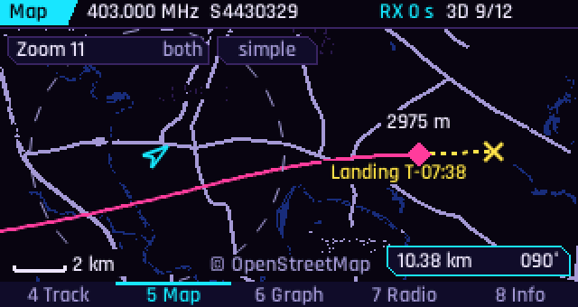
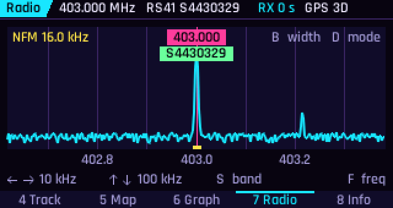
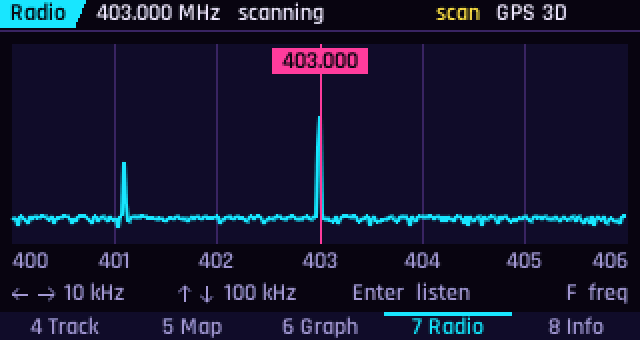
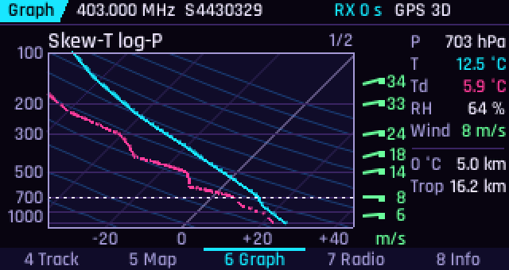
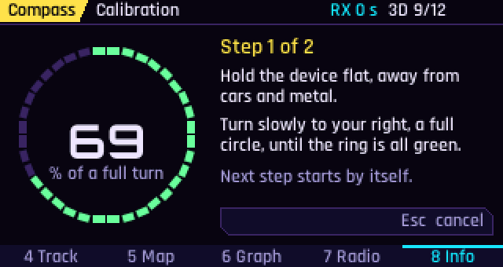
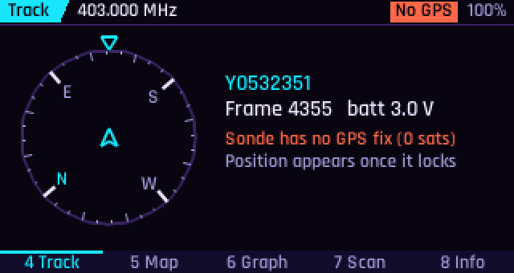

# SondeChase

[English](README.md) | **Tiếng Việt**

[](https://github.com/hieuha/CardputerZero-Sondechase/actions/workflows/tests.yml)
[](https://github.com/hieuha/CardputerZero-Sondechase/actions/workflows/package.yml)
[](https://github.com/hieuha/CardputerZero-Sondechase/actions/workflows/validate.yml)
[](https://github.com/hieuha/CardputerZero-Sondechase/releases/latest)
[](LICENSE)
[](https://docs.m5stack.com/)
[](https://lvgl.io)

> **Mới dùng lần đầu? Xem [bảng phím tắt](docs/keyboard-cheatsheet.md)** (tiếng Anh) để biết mọi phím trên từng màn hình.

Ứng dụng thu, giải mã và bám theo bóng thám không RS41 cho M5Stack CardputerZero (Raspberry Pi CM0, màn hình
320×170, bàn phím 46 phím), dùng một RTL-SDR (hoặc HackRF) và GPS (không bắt buộc).

Phiên bản 0.6.0. Đã chạy trên CardputerZero thật với RTL-SDR Blog V4: phần quét và giải mã đã được kiểm với một quả
RS41 đang bay (Y0532351). Chưa thử đi săn ngoài thực địa với GPS; xem [Hạn chế đã biết](#hạn-chế-đã-biết).

| | |
|---|---|
|  |  |
| **Track**: khoảng cách tới sonde và hướng cần đi, viết bằng chữ; điểm rơi dự đoán | **Map**: kiểu đơn giản (sông hồ và đường), đường bay, điểm rơi |
|  |  |
| **Radio**: phổ quanh tần số đang chỉnh, nghe NFM, `Enter` để giải mã | **Radio, Scan** (`S`): tìm các đỉnh tín hiệu và thử giải mã từng đỉnh; phím mũi tên để chọn tay |
|  |  |
| **Graph**: Skew-T log-P của chuyến thám không | **Graph**: độ cao và tốc độ đứng, có đánh dấu điểm nổ |
|  |  |
| **Info 1/2**: sonde, thu sóng, thiết bị, toạ độ điểm rơi | **Info 2/2** (`→`): toạ độ, hướng, góc ngẩng, tốc độ, thời tiết; `K` để hiệu chỉnh la bàn |
|  |  |
| **Track, mất GPS**: khoảng cách và hướng tính từ vị trí GPS cuối của máy, màu vàng | **Hiệu chỉnh la bàn** (Info, `K`): xoay một vòng, nghiêng về bốn phía rồi hướng máy về phía Bắc |
|  |  |
| **Cảnh báo bóng nổ**: tốc độ rơi, thời gian và khoảng cách tới điểm rơi | **Track, đúng hướng**: vòng la bàn và dòng `Go` chuyển xanh khi lệch không quá 15° |

Đây là ảnh mô phỏng: chính code giao diện của app (`tools/render.c`) vẽ một chuyến bay giả lập, phổ radio là dữ liệu
dựng sẵn, bản đồ lấy từ tile OpenStreetMap. Phóng to 2×.

Trên máy thật (chụp framebuffer, 2×):

| | |
|---|---|
|  |  |
| **Track**: một quả RS41 thật (Y0532351) đang chờ GPS fix | Biểu tượng trong launcher **APPLaunch** |
|  |  |
| **Giữ `Esc`** để thoát | **Radio** với RTL-SDR Blog V4 thật, đang nghe một đài FM (lúc đó không có sonde trên trời) |

## Phần cứng

| Thiết bị | Ghi chú |
|---|---|
| M5Stack CardputerZero | Raspberry Pi CM0, Debian 13 arm64, màn hình 320×170, bàn phím 46 phím, âm thanh qua PipeWire |
| RTL-SDR | Đã thử: RTL-SDR Blog V4 (tuner R828D). Các dongle RTL2832U khác chưa được thử |
| HackRF (thay cho RTL-SDR) | HackRF One hoặc rad1o, app tự nhận qua USB; gói cài sẵn `libhackrf0`. Đã thử với HackRF One: quét và nghe WFM; chưa thử giải mã RS41 |
| GPS (không bắt buộc) | Bất kỳ GPS nào gpsd đọc được, ví dụ GPS USB. Cần cho khoảng cách, hướng, điểm rơi và beeper |
| Cảm biến từ trường (không bắt buộc) | Cảm biến IIO trên bo mạch, dùng làm hướng khi chưa có hướng di chuyển từ GPS |
| Đèn ACT | Đèn đỏ nháy mỗi khi nhận được frame, ở màn Track và Map |

Không có GPS thì sonde vẫn được giải mã và telemetry vẫn hiện; beeper không kêu.

## Cài đặt

Tải `sondechase_0.6.0-rev1_arm64.deb` từ [bản release mới nhất](https://github.com/hieuha/CardputerZero-Sondechase/releases/latest),
chép vào máy rồi cài:

```sh
sudo apt install --no-install-recommends ./sondechase_0.6.0-rev1_arm64.deb
```

Mở **SondeChase** từ APPLaunch. Gói cài đã kèm sẵn bộ giải mã RS41 (`fsk_demod` và `rs41mod`, lấy từ
`radiosonde_auto_rx`). Gói cần `librtlsdr0`, `libhackrf0` và `curl`; nên cài thêm `gpsd` và `pulseaudio-utils`.

Muốn tự build gói (trên máy hoặc cross-compile), xem [hướng dẫn deploy](docs/deployment-guide.md).

## Phím

| Phím | Chức năng |
|---|---|
| `4` Track | La bàn HUD và khoảng cách tới sonde, kèm hướng cần đi viết bằng chữ (`Bear right, East`, `Straight ahead`), độ cao, hướng trôi và điểm rơi dự đoán. Vòng la bàn và dòng `Go` chuyển xanh khi mũi tên lệch không quá 15° so với hướng đang đi. Khi mất GPS, khoảng cách và hướng tính từ vị trí GPS cuối cùng của máy (màu vàng, `from last GPS`). Khi sonde chưa có GPS fix: số hiệu, frame và pin. Mỗi frame kêu tít và nháy đèn đỏ |
| `5` Map | Tile bản đồ, vị trí máy, sonde, đường bay, điểm rơi. Phím mũi tên để kéo bản đồ (giữ để kéo liên tục; bản đồ thôi bám theo, hiện `free`). `Sym` + `T` (`+`) để phóng to, `Sym` + `R` (`-`) để thu nhỏ. `C` chuyển vòng giữa cả hai / theo máy / theo sonde, hoặc bám theo lại sau khi kéo. `V` đổi kiểu đơn giản / chi tiết. Khi chưa có vị trí nào: lấy tâm ở `map_lat` / `map_lon` |
| `6` Graph | `Left` / `Right` để đổi trang: Skew-T log-P, độ cao và tốc độ đứng theo thời gian |
| `7` Radio | Phổ kèm âm thanh của tần số đang chỉnh. `Left` / `Right` ±10 kHz, `Up` / `Down` ±100 kHz (giữ để chỉnh liên tục). `Enter` để giải mã tại đó. `S` để Scan, `Esc` để quay lại. `D` đổi chế độ (NFM / AM / USB / LSB / WFM), `B` đổi độ rộng kênh |
| `8` Info | `K` để hiệu chỉnh la bàn (xoay máy một vòng sang phải, nghiêng máy về trước, sau, trái, phải, rồi hướng máy về phía Bắc và bấm `Enter`; lưu vào `<data_dir>/compass.conf`). `Left` / `Right` để chuyển trang: 1/2 sonde, thu sóng, thiết bị, điểm rơi; 2/2 số liệu chi tiết (toạ độ, hướng, góc cần rẽ, góc ngẩng, tốc độ, nhiệt độ, độ ẩm, áp suất, vị trí máy) |
| `Tab` | Sang màn tiếp theo (Track → Map → Graph → Radio → Info → Track) |
| `F` | Nhập tần số theo kHz; `Enter` để chỉnh tới tần số đó (trong dải của tuner) và giải mã |
| `S` | Scan dải 400–406 MHz và thử giải mã các đỉnh tín hiệu (xem [Màn hình Radio](#màn-hình-radio)) |
| `X` | Dừng bộ thu |
| `R` | Khởi động lại bộ giải mã ở tần số hiện tại |
| `M` | Tắt / bật tiếng beeper, tiếng tít mỗi frame và âm thanh radio (đèn vẫn nháy) |
| Giữ `Esc` 3 giây | Thoát (hiện đếm ngược; bấm `Esc` nhanh hoặc bấm nhầm phím khác không bao giờ làm thoát app) |

Cảnh báo bóng nổ hiện đè lên mọi màn hình: `Enter` để mở Map, bấm nhanh `Esc` để tắt cảnh báo.

## Các màn hình

| Màn hình | Nội dung |
|---|---|
| Track | Vòng la bàn, mũi tên chỉ tới sonde, khoảng cách, hướng cần đi, độ cao, hướng trôi, điểm rơi; thanh trên cùng có tần số, trạng thái và GPS |
| Map | Tile OpenStreetMap (tải khi cần), vị trí máy, sonde, đường bay, điểm rơi |
| Graph | Skew-T log-P (`Graph 1/2`) và độ cao / tốc độ đứng, có đánh dấu điểm nổ (`Graph 2/2`) |
| Radio | Phổ trực tiếp quanh tần số đang chỉnh, vùng tô màu thể hiện độ rộng kênh, trạng thái giải mã |
| Info | Trang 1: ID sonde, số frame, pin, chi tiết GPS và thu sóng. Trang 2: toạ độ, hướng, góc ngẩng, tốc độ, nhiệt độ, độ ẩm, áp suất. Số trang nằm ở nhãn góc trái trên (`Info 1/2`) |

### Màn hình Radio

- Khi mở app mà chưa đặt `freq_hz`, SondeChase nghe ở giữa dải (403 MHz) và phát âm thanh. Chỉnh tần số chỉ để nghe.
  `Enter` sẽ bật bộ giải mã ở tần số đó; thanh trên cùng hiện `listen` hoặc `decode`.
- **Scan** (`S`): quét liên tục dải 400–406 MHz. Sau hai lượt quét, app thử giải mã đỉnh có tín hiệu lớn nhất trong
  10 giây. Nhận được frame RS41 thì dừng quét tại đó (`found RS41 …`). Không nhận được thì bỏ qua đỉnh đó trong 2 phút
  và quét tiếp. Phím mũi tên để tự chọn; `Enter` để chỉnh tới vị trí con trỏ; `Esc` để quay lại tần số trước đó.
- Frame giải mã được sẽ ghi lại tần số của nó; trên phổ, tần số đó được gắn số hiệu sonde.

### Khi không có bộ thu hoặc GPS

- **Chưa cắm SDR vào USB**: hiện màn hình "No SDR device found". App kiểm tra USB mỗi 2 giây và chạy tiếp khi thấy
  RTL-SDR hoặc HackRF. Tắt bước kiểm tra này bằng `sdr_check = 0`.
- **Máy chưa có GPS fix**: vẫn giải mã bình thường. Thanh trên cùng hiện `GPS 0/3` màu đỏ khi GPS đã cắm nhưng chưa
  fix (số vệ tinh đang dùng / thấy được), `GPS lost` khi đã từng có fix, hoặc `No GPS`. Khi có fix thì hiện `3D 9/12`.
  Nếu máy đã từng có fix, màn Track vẫn hiện khoảng cách và hướng, tính từ vị trí cuối cùng của máy.
- **Sonde chưa có GPS fix** (còn dưới đất): không dùng vị trí của nó; Track và Info hiện số hiệu, frame, số vệ tinh và
  pin.

## Cấu hình nhanh

File cấu hình là `/etc/sondechase.conf`. Mỗi dòng có dạng `key = value`; `#` bắt đầu một ghi chú, ở đầu dòng hoặc sau
một khoảng trắng. Mọi key đều không bắt buộc.

```ini
freq_hz = 403000000      # giải mã ngay khi mở app (bỏ trống: mở màn Radio)
gain = 38.6              # gain của tuner, dB (bỏ trống: AGC của tuner)
sdr = auto               # bộ thu: auto (tự nhận qua USB), rtlsdr hoặc hackrf
sdr_check = 1            # bắt buộc có bộ thu trên USB
gpsd_port = 2947         # gpsd (0 để tắt GPS)
burst_alt = 30000        # độ cao nổ giả định khi bóng đang lên, m
tile_online = 1          # tải các tile bản đồ đang hiện trên màn hình
tile_cache_mb = 1000     # giới hạn cache tile, MB (tile đã xem được giữ để dùng khi không có mạng)
map_simple = 1           # kiểu bản đồ đơn giản (V trên màn Map để đổi)
demo = 0                 # 1 = chuyến bay giả lập, không cần phần cứng
```

App tự tìm màn LCD (`/dev/fb_lcd`, không có thì đọc `/proc/fb`), nên vẫn hiện đúng khi cắm HDMI. Chỉ đặt `fb_dev`
khi muốn ép dùng một framebuffer khác.

Danh sách đầy đủ các key, giá trị mặc định, đóng gói và gói tile bản đồ: [hướng dẫn deploy](docs/deployment-guide.md#configuration).

Chế độ demo (`demo = 1`) phát một chuyến bay giả lập qua đúng luồng code thật, tiện để xem mọi màn hình khi không có
dongle.

## Dữ liệu và cache bản đồ

Mọi dữ liệu app lưu nằm trong một thư mục, `data_dir` (mặc định `~/sondechase`):

```
~/sondechase/
├── sondechase.csv   # mọi frame hợp lệ, ghi nối tiếp qua các lần mở app
├── log/             # mỗi sonde một file log theo định dạng radiosonde_auto_rx
└── tiles/           # các tile bản đồ đã tải (bản đồ dùng khi không có mạng)
```

- `log/YYYYMMDD-HHMMSS_<serial>_RS41_<MHz>_sonde.log`: giờ ghi theo UTC, lấy từ GPS của chính sonde, nên vẫn đúng
  ngoài thực địa khi không có mạng. SNR và lệch tần ghi là `-1`.
- `tiles/`: mọi tile đã hiện trên màn Map đều được giữ lại và dùng trước khi tải qua mạng, nên vùng đã xem một lần sẽ
  xem được khi không có mạng. Trước khi đi săn, bạn nên mở Map xem qua khu vực đó ở các mức zoom cần dùng khi còn
  Wi-Fi. Cache giữ tối đa `tile_cache_mb` (1000 MB), vượt quá thì xoá các tile cũ nhất.
- File từ các bản trước 0.5.1 (`~/sondechase.csv`, `~/.cache/sondechase/tiles`) được tự chuyển vào đây ở lần mở app
  đầu tiên.

## Tài liệu

Tài liệu kỹ thuật viết bằng tiếng Anh:

| Tài liệu | Nội dung |
|---|---|
| [Keyboard cheatsheet](docs/keyboard-cheatsheet.md) | Mọi phím tắt, theo từng màn hình |
| [Project overview and PDR](docs/project-overview-pdr.md) | Phạm vi, yêu cầu, tiêu chí nghiệm thu |
| [System architecture](docs/system-architecture.md) | Module, luồng dữ liệu, thiết bị ngoại vi, thuật toán (DSP, giải điều chế, dự đoán điểm rơi, phát hiện nổ, beeper), bản đồ và tile |
| [Code standards](docs/code-standards.md) | Quy ước C, đặt tên, test, commit |
| [Codebase summary](docs/codebase-summary.md) | Các file và vai trò của từng file |
| [Deployment guide](docs/deployment-guide.md) | Build, test, cài đặt, danh sách cấu hình, các bước release, kiểm tra trên máy |
| [Project roadmap](docs/project-roadmap.md) | Các phiên bản đã phát hành, những phần còn thiếu |
| [Publish record](PUBLISH.md) | Những gì gửi lên app store CardputerZero: gói, trang store, ảnh, lần nộp gần nhất |

## Tình trạng test

`tests/test_core.c`: 4426 phép kiểm, 0 lỗi trên Debian 13 (GCC 14.2). CI chạy test lõi trên Ubuntu và build gói arm64
native trên Debian 13. Một `librtlsdr` giả và một bộ giải mã giả chạy trọn quy trình quét và giải mã mà không cần
dongle. Chi tiết và số đo trên máy thật: [hướng dẫn deploy](docs/deployment-guide.md#tests).

## Hạn chế đã biết

- Chỉ hỗ trợ RS41. Các loại sonde khác cần bộ giải mã riêng.
- HackRF không có AGC nên gain mặc định là cố định (LNA 32 + VGA 24 dB; `hackrf_gain` đặt tổng gain). Ở 400 MHz,
  HackRF kém nhạy hơn RTL-SDR.
- Ở gần một sonde phát rất mạnh, màn tổng quan có thể hiện thêm vài đỉnh phụ yếu hơn; chỉnh tới đó sẽ không có gì để
  giải mã.
- La bàn cần hiệu chỉnh một lần (màn Info, phím `K`: xoay máy một vòng, nghiêng về bốn phía rồi hướng về phía Bắc).
  Sau đó la bàn được bù độ nghiêng nhờ gia tốc kế, nên không cần cầm máy nằm ngang (trừ khi đầu máy chĩa gần thẳng lên
  trời hoặc xuống đất, trong khoảng 15°). Trước khi hiệu chỉnh, chỉ nên tin hướng khi đang di chuyển nhanh hơn khoảng 5,4 km/h (1,5 m/s, `cog_min_speed`)
  (hướng GPS).
- Skew-T dừng ở 100 hPa; chưa vẽ đường đoạn nhiệt ẩm và đường tỉ lệ hỗn hợp.
- Dự đoán điểm rơi khi bóng đang lên phụ thuộc vào `burst_alt` giả định.
- Lịch sử chuyến bay không được khôi phục sau khi mở lại app.
- Chưa kiểm ngoài thực địa: GPS, beeper, phát hiện nổ và điểm rơi trên một chuyến bay thật. Danh sách đầy đủ trong
  [roadmap](docs/project-roadmap.md#known-gaps).

## Giấy phép

SondeChase phát hành theo GNU General Public License phiên bản 3, hoặc (tuỳ bạn chọn) bất kỳ phiên bản nào mới hơn
(`GPL-3.0-or-later`), xem [`LICENSE`](LICENSE).

Thành phần của bên thứ ba:

| Thành phần | Giấy phép |
|---|---|
| `rs41mod` (zilog80, [rs1729/RS](https://github.com/rs1729/RS), qua [radiosonde_auto_rx](https://github.com/projecthorus/radiosonde_auto_rx)) | GPL-3.0 |
| `fsk_demod` ([codec2](https://github.com/drowe67/codec2), David Rowe) | LGPL-2.1 |
| Front end của bộ giải mã trong `src/dsp.c`, port từ `rtl_fm.c` ([rtl-sdr](https://gitea.osmocom.org/sdr/rtl-sdr)) | GPL-2.0-or-later |
| `librtlsdr` (nạp lúc chạy) | GPL-2.0-or-later |
| [LVGL](https://github.com/lvgl/lvgl) v9.5 | MIT |
| Các file trong `cmake/` lấy từ CardputerZero Template | MIT, xem `cmake/LICENSE-CardputerZero-Template.txt` |
| Font Rajdhani, Orbitron | SIL OFL 1.1, xem `assets/fonts/OFL-*.txt` |
| Dữ liệu bản đồ | © OpenStreetMap contributors, ODbL |
