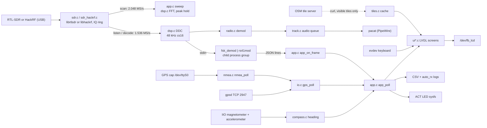

# System Architecture

Last updated: 2026-11-20 (version 0.7.0).

SondeChase is one C11 process on the CardputerZero. It reads the RTL-SDR or HackRF in process, runs the RS41 decoder as
a child pipeline, merges GPS and magnetometer data, and draws every screen with LVGL 9.5 on the LCD framebuffer.
The core (`sc_core`) has no LVGL dependency and is unit-tested on any Linux host.

## Contents
- [Components](#components)
- [Diagram](#diagram)
- [Processes and threads](#processes-and-threads)
- [Receiver ownership and states](#receiver-ownership-and-states)
- [Data flows](#data-flows)
- [Peripherals](#peripherals)
- [Algorithms](#algorithms)
- [Map and tiles](#map-and-tiles)
- [Files written](#files-written)
- [Failure handling](#failure-handling)

## Components

| File | Lines | Responsibility |
|---|---|---|
| `src/sc.h` | 574 | The only public header: config, parsers, DSP, SDR, scan, app state and every module API |
| `src/main.c` | 92 | Entry point, signal handling, main loop, LVGL setup, hold-Esc quit |
| `src/app.c` | 630 | State machine (`ST_IDLE`, `ST_SCAN`, `ST_LISTEN`, `ST_DECODE`), receiver ownership, decoder pipeline, sweep, Scan hunt, frame handling, CSV and auto_rx logs |
| `src/base.c` | 426 | `sc_now`, config parser and defaults, line reader, child process groups, flat-JSON field extraction |
| `src/sdr.c` | 332 | Receiver front: IQ ring, `sdr_*` calls dispatched to a back end; RTL-SDR back end (`librtlsdr` loaded with `dlopen`, reader thread, tuner range table) |
| `src/sdr_hackrf.c` | 318 | HackRF back end: `libhackrf` loaded with `dlopen`, int8 to u8 IQ, halving to reach rates under 2 MS/s, retune-safe transfers |
| `src/sdr_priv.h` | 32 | Back-end interface (`sdr_ops_t`) shared by the two |
| `src/dsp.c` | 234 | FFT, decoder front end (DDC: rotation, half-band decimation, droop FIR), wide 192 kHz stream |
| `src/radio.c` | 207 | Audio demodulators for NFM, AM, USB, LSB, WFM |
| `src/io.c` | 292 | gpsd client (TPV and SKY), USB SDR presence, spectrum cells and peaks |
| `src/nmea.c` | 167 | Serial GPS read by the app (a GPS cap): port, baud search, NMEA GGA, RMC, GSA, GSV |
| `src/compass.c` | 399 | Heading sources, magnetometer and accelerometer, tilt compensation, compass calibration |
| `src/geo.c` | 223 | Geodesy, ISA, dew point, wind profile, sonde JSON parse, landing prediction |
| `src/track.c` | 333 | Flight history, burst detection, proximity beeper, PCM audio stream to `pacat`, frame LED, EXT 5 V switch, slippy-map maths |
| `src/tiles.c` | 326 | Tile lookup, `curl` downloads with cache cap and failure reasons, recolouring |
| `src/demo.c` | 139 | Simulated flight (`demo = 1`) through the same frame path |
| `src/keys.c` | 97 | Keyboard from evdev (`/dev/input/event*`), Sym symbol keys, held-arrow repeat |
| `src/ui.c` | 258 | UI state, overlays (frequency entry, burst alert, no SDR), LVGL draw callback, key dispatch (`ui_key`) |
| `src/ui_draw.c` | 254 | Drawing primitives (line, rectangle, label), top and nav bars, battery |
| `src/ui_track.c` | 223 | Track screen and compass |
| `src/ui_map.c` | 290 | Map screen, decoded tile cache, pan, zoom, follow, style |
| `src/ui_graph.c` | 168 | Skew-T and flight profile |
| `src/ui_radio.c` | 159 | Band overview, tuned spectrum, listening, decoding |
| `src/ui_info.c` | 177 | Info screens and compass calibration |
| `src/ui_priv.h` | 77 | Colours, shared UI state and prototypes for the UI files |
| `src/ui.h` | 16 | UI entry points used by `main.c` |
| `tools/render.c` | 226 | Headless build of the real UI for screenshots (`SC_RENDER`) |

The UI is one file per screen (see [code standards](./code-standards.md#file-size)).

## Diagram

## Processes and threads

| Unit | Kind | Notes |
|---|---|---|
| Main process | Single thread | Keys, `app_poll`, `lv_timer_handler`, sleep of 5 to 30 ms per loop. While scanning with the sweep running, the wait is capped at 10 ms |
| librtlsdr reader | Thread in `sdr.c` | Runs librtlsdr's async read and writes IQ bytes into a 4 MiB lock-free ring (about 1.4 s at 1.536 MS/s). Drops are counted, never block the reader |
| libhackrf USB thread | Thread owned by libhackrf, callback in `sdr_hackrf.c` | Halves each transfer to 1.536 MS/s into the same kind of ring; the callback runs under a lock and drops transfers that began before the last retune |
| Decoder pipeline | `sh -c` child in its own process group | `fsk_demod --cs16 ... \| rs41mod --json ...`. Stdin is fed by the app; stdout is read line by line |
| Audio | `sh -c` child (`audio_cmd`, default `pacat`) | Receives 16 kHz S16_LE mono PCM: beeper tones and, on the Radio screen, the demodulated audio |
| Tile fetch | `sh -c` children (`tile_fetch_cmd`, `curl`) | At most `TF_JOBS` = 2 at a time |
| Tile cache sweep, blocked-name lookup | Forked children of the app | Run off the main loop: the sweep stats every cached file, and a DNS lookup can block for seconds without a network |
| gpsd | Non-blocking TCP socket | The connect itself is non-blocking (given up after 5 s); sends `?WATCH` JSON; reconnect every 5 s, a name that does not resolve every 30 s |

The app sets itself as a child subreaper (`PR_SET_CHILD_SUBREAPER`). Process-group members that a shell leaves
behind are reaped by the app (`reap_group`) instead of becoming zombies under the launcher.

The app ignores `SIGPIPE`; its `sh -c` children get it back at its default, with no signals blocked
(`sc_child_setup`), so a decoder stage whose reader died ends too and the app sees the pipeline exit.

The main loop never waits on the receiver: one `app_poll` processes at most about 160 ms of IQ, so a core that
falls behind the stream (throttled on battery) loses samples, counted by the ring, instead of freezing the UI.

## Receiver ownership and states

The dongle is opened once per session and kept open (`app_t.rx`). The band sweep and the tuned receiver take turns
on it: the sweep runs at `SWEEP_RATE` (2.048 MS/s), listening and decoding at `DDC_RATE` (1.536 MS/s). Switching
job restarts only the USB stream at the other rate.

| State | Entered by | Receiver | Decoder | Audio and spectrum |
|---|---|---|---|---|
| `ST_IDLE` | initial state; `app_stop` (`X`) | none | no | none |
| `ST_SCAN` | `app_scan`, `app_hunt` (`S`) | sweep at 2.048 MS/s | no. A hunt switches to `ST_DECODE` for each peak it tries | band overview |
| `ST_LISTEN` | `app_listen`: tuning with arrow keys, startup without `freq_hz` | tuned at 1.536 MS/s | no | tuned spectrum and radio audio |
| `ST_DECODE` | `app_tune`: `Enter`, `F` + frequency, `R`, `freq_hz` at start-up | tuned at 1.536 MS/s | yes, `fsk_demod \| rs41mod` | spectrum while the Radio screen is shown |

- Start-up: with `freq_hz` set the app decodes that frequency. Without it the app opens on the Radio screen and
  listens at the middle of the scan band (403.000 MHz with the default range).
- Scan hunt (`app_hunt`): after two completed sweep passes, the strongest peak at least `HUNT_SNR_DB` (10 dB) above
  the floor is tried with the decoder for `HUNT_TRY_S` (10 s). An RS41 frame on it ends the hunt there. Otherwise the
  peak is skipped for `HUNT_SKIP_S` (120 s); up to `HUNT_SKIP_N` (16) peaks are remembered.
- Missing receiver: with `sdr_check = 1` the USB bus is scanned every 2 s (`sdr_present`). Without a receiver the
  UI shows the "No SDR device found" screen and nothing runs. A receiver that disappears is closed whatever the
  job, even while paused, and reopened when it is back.
- A stream that ends during Scan (unplugged, or a USB hiccup) leaves the state at `ST_SCAN`: the sweep starts
  again after 2 s, then every 3 s until it can. A sweep step whose retune failed (outside the tuner's range) is
  not added to the overview.

## Data flows

### Receive and decode

1. `sdr_open` picks the back end (`sdr`; `auto` looks at USB with `sdr_present`), which loads its library
   (`librtlsdr.so.0` or `libhackrf.so.0`, overridable with `rtlsdr_lib` / `hackrf_lib`), applies `ppm`, `gain`
   (HackRF: `hackrf_gain`),
   `bias_tee`, and starts streaming u8 IQ into the ring. See [receiver back ends](#receiver-back-ends).
2. `rx_poll` (in `app.c`) drains the ring in 64 KiB reads. For each read it:
   - runs `ddc_process_wide` (see [Algorithms](#algorithms)) and writes 48 kHz cs16 pairs to the decoder pipe with
     `proc_feed`. Writes the child cannot accept are dropped and counted (`wdrop`); no sample alignment is lost;
   - when the Radio screen is on (`radio_audio`), demodulates the tuned frequency with `radio_process` (or
     `radio_process_wfm` for WFM) and pushes the audio to the audio queue;
   - every 50 ms, while the Radio screen is shown, computes the live spectrum (5 FFTs, 1024 points).
3. `app_poll` reads the decoder's stdout with `lr_readline`. Lines that start with `{` go to `app_on_frame`.
   Other text is ignored.
4. `app_on_frame` calls `sonde_parse`:
   - return 1 (valid position): the sonde becomes the current sonde; known frequencies are updated; wind profile
     (if ascending), history, burst detection, landing prediction and the logs are updated;
   - return 2 (telemetry without a GPS solution, fewer than 4 satellites): stored as `nofix` only. It is not added
     to the track, history, prediction or logs;
   - return 0: ignored.
5. On a valid frame `app_on_frame` also plays the frame tick and blinks the LED when a Track or Map screen is on
   (`frame_cue`).

Frames from a new serial reset the wind profile, history, flight phase and burst alert.

### Scan sweep

`sweep_poll` takes `SWEEP_FRAMES` (5) FFTs per retune step, folds them into `spectrum_t` cells with peak hold, and
steps through the band. `spec_peaks` returns the peaks for the Radio screen and for the hunt. Known sondes
(`known_t`, up to 16 frequencies within 10 kHz) label their peaks with the serial.

### Position, heading and derived values

`app_poll` each loop:
- `gps_poll` reads gpsd. A fix is valid for 5 s after its last TPV report (`gps_ok`). SKY reports give satellites
  in view and used (`gps_sky`).
- `heading_update` picks the compass source in this order: GPS course when speed ≥ `cog_min_speed`, the magnetometer
  when found (read at 5 Hz), otherwise hold the last heading (`HDG_HOLD`). With `mag_tilt = 1` the magnetometer
  heading is tilt-compensated (see [compass](#compass-compassc)).
- With a sonde and a valid GPS fix: ground distance, bearing, elevation angle (also on Track, from the last fix
  when GPS drops out, hidden once the sonde has landed) and the relative bearing for the
  arrow. Landing point distance and bearing when a prediction exists.
- The proximity beeper (`prox_update`) and the telemetry tones use the ground distance.

### Radio audio

`radio.c` shifts the 48 kHz stream by −12 kHz so the tuned frequency sits at 0 Hz, filters the channel, demodulates,
and decimates to 16 kHz. Output goes to `audio_radio_push`, which mixes it with beeper tones in one `pacat` stream.

### Output

- Screens: a 200 ms LVGL timer (`tick_cb`) and every key press invalidate the root object. The single
  `LV_EVENT_DRAW_MAIN` callback (`draw_cb`) repaints the active screen from `app_t`, immediate-mode style. LVGL
  writes to the LCD framebuffer through `lv_linux_fbdev`; `fb_pick` (`base.c`) chooses it at start: `fb_dev`, then `$LV_LINUX_FBDEV_DEVICE`, then `/dev/fb_lcd`, then `/proc/fb`, then `/dev/fb0`.
- Logs: see [Files written](#files-written).
- Burst: `flight_update` returns 1 once, sets `burst_alert`, and plays three rising tones (880, 1320, 1760 Hz).

## Peripherals

| Peripheral | Interface | Access | Notes |
|---|---|---|---|
| RTL-SDR (RTL2832U) | USB, `librtlsdr` | `dlopen` at run time; `rtl_dev` index | Matches VID:PID `0bda:2838` or `0bda:2832` for the presence check. Tested: RTL-SDR Blog V4 (R828D tuner) |
| HackRF One / rad1o | USB, `libhackrf` | `dlopen` at run time; `rtl_dev` index | `1d50:6089` or `1d50:cc15`. 1 MHz to 6 GHz. Tried with a HackRF One on the device (libhackrf 2024.02.1): scan and WFM audio clear, about 20 % of one core while decoding and playing WFM; no RS41 received in the one live test ([issue #1](https://github.com/hieuha/CardputerZero-Sondechase/issues/1)) |
| GPS | gpsd, TCP `127.0.0.1:2947` (`gpsd_host`, `gpsd_port`) | Non-blocking socket and connect, JSON `TPV` and `SKY` (a fix with a non-finite or out-of-range position is ignored) | `gpsd_port = 0` turns it off. A USB GPS can be plugged in while the app runs; gpsd picks it up. Used first: while a TPV arrived within 3 s, the serial GPS is ignored |
| GPS cap | Serial `gps_serial` (default `/dev/ttyS0`, the LoRa-1262 cap) | Non-blocking read, opened with `TIOCEXCL`; 115200 then 9600 baud, switched after 3 s without a good sentence; NMEA GGA, RMC, GSA, GSV, checksum required | Needs the EXT 5 V on (below). gpsd and the app exclude each other on the port. Not opened or lost: retried every 5 s |
| EXT 5 V (GPS cap) | sysfs `ext_power_path` (default `/sys/class/leds/ext_5v_out/brightness`, IO13 of the m5ioe1 expander) | `power_set` in `app_init` reads the state and writes `1`; `app_free` writes `0` after closing the GPS port, only if it was off before | Off at boot (`cardputerzero-v5-overlay`), so a cap on the EXT header has no power until something switches it on. Writable by the `gpio` group, which `pi` is in. A crash or SIGKILL leaves it on. Missing or not writable: nothing happens |
| Magnetometer | IIO sysfs `/sys/bus/iio/devices/iio:deviceN/in_magn_{x,y,z}_raw` (BMM150) | Read at 5 Hz | `mag_enable`, `mag_off_x/y/z`, `mag_rot_deg`, `mag_flip_y`, `declination` |
| Accelerometer | IIO sysfs `in_accel_{x,y,z}_raw` (BMI270) | Read at 5 Hz with the magnetometer, low-passed (about 0.6 s) | Used only for tilt compensation (`mag_tilt`, `accel_axes`). Without it the compass assumes the device is flat |
| ACT LED | sysfs `led_path` (default `/sys/class/leds/ACT/brightness`) | One-byte write per blink | Writable by the `input` group. The first blink drops the kernel's `actpwr` trigger until reboot |
| Audio | `pacat` via `audio_cmd` (PipeWire) | Child stdin, 16 kHz S16_LE mono | `audio_enable`. Without PipeWire, `aplay` can be used through `audio_cmd` |
| Display | `/dev/fb_lcd` (found by `fb_pick`), `fb_dev` | LVGL `lv_linux_fbdev` | 320×170 |
| Keyboard | evdev, `/dev/input/event*` | Non-blocking read, device grabbed | `kbd_dev` sets the device; empty auto-detects the first device with Q, Enter and 1 keys |
| Network (tiles) | HTTPS via `curl` | Child process | Only when `tile_online = 1` |

Battery: read from sysfs every 10 s for the top bar.

## Algorithms

### Band sweep

- 2.048 MS/s; the central 80 % of each 1024-point FFT is kept (2 kHz bins), so each retune step covers
  1.6384 MHz. Four steps cover the 400–406 MHz default band.
- After each retune: 15 ms of IQ are discarded, plus one 16 KiB USB transfer. Then 5 FFT frames are averaged.
- The tuner's DC offset and LO leakage create false peaks within 50 kHz of each tuning centre. Each step ignores
  that zone. Odd passes are shifted by half a step so the neighbouring step measures it. The tuned view interpolates
  across it.
- Peak hold: each cell keeps its value against the previous pass decayed by 3 dB, so a sonde's peak stays steady
  between frames and a signal that stops fades within seconds.
- Measured on the device: a full 400–406 MHz pass about every 0.25 s (see [deployment guide](./deployment-guide.md#device-checks)).

### Decoder front end (`dsp.c`)

Port of `rtl_fm -M raw -F9 -s 48000` (rtl-sdr 2.0.2 chain):

1. The dongle is tuned to `f − 12 kHz + 384 kHz` (`DDC_RATE / 4` above the wanted centre), so the RS41 sits at
   +12 kHz in the stream and the DC spike is away from it.
2. A 90° rotation (phase steps 0 to 3) brings the band to 0 Hz.
3. Five binomial half-band stages decimate by 2 each (32 in total), giving 48 kHz.
4. A 9-tap FIR compensates the droop.
5. The 48 kHz complex int16 stream goes to `fsk_demod --cs16`.

The same routine also gives the 192 kHz stream after the third halving (`DDC_WIDE_RATE`) for WFM.

The rotation runs four pairs at a time without a branch, and each halving filters I and Q together from a copy of
the block (`ddc_t.work`), so the compiler vectorises it. The numbers are rtl_fm's bit for bit, including its habit of
never using a block's last sample in the next halving: a test checks a hash of the output for fixed noise in uneven
chunks against the in-place original.

Cost per second of signal on the CardputerZero (Cortex-A53, 1 GHz), from a benchmark of each stage on the device:

| Stage | Before | Now |
|---|---|---|
| Decoder front end (1.536 MS/s to 48 kHz) | 80 ms | 30 ms |
| HackRF halving (3.072 to 1.536 MS/s) | 57 ms | 22.5 ms |
| HackRF int8 to u8 (scan, 2.048 MS/s) | 43 ms | 3.4 ms |
| NFM audio | 39 ms | 26.6 ms |
| WFM audio | 43 ms | 26.5 ms |
| Live spectrum (20 × 5 FFTs of 1024) | 29 ms | 29 ms |

### Radio demodulation (`radio.c`)

| Mode | Input | Method | Output |
|---|---|---|---|
| NFM | 48 kHz | Phase-difference discriminator on a 63-tap channel filter (real taps; SSB needs the complex ones); noise squelch on the mean square over 20 ms, threshold per channel width; closed squelch is a murmur | 16 kHz |
| AM | 48 kHz | Envelope, gain follows the carrier level | 16 kHz |
| USB / LSB | 48 kHz | Complex filter keeps one sideband; real part with AGC | 16 kHz |
| WFM | 192 kHz | Same discriminator (±75 kHz), 50 µs de-emphasis, 10 kHz low-pass, decimate by 12 | 16 kHz |

Channel widths: NFM 16 / 25 / 6 / 12 kHz (16 kHz default), AM 6 / 10 kHz, SSB 2.4 / 3 kHz, WFM 180 kHz (display only;
the 192 kHz stream is the channel).

The discriminators use `fast_atan2f`, a polynomial within 1.2e-5 rad (far below audibility): glibc's `atan2f` took
about 230 ns per call on the device, nearly all of WFM's cost at 192 000 calls a second.

### Sonde JSON and position validity (`geo.c`)

`sonde_parse` reads the flat JSON that `rs41mod` prints (`lat`, `lon`, `alt`, `id`, `frame`, `sats`, `vel_v`,
`vel_h`, `heading`, `temp`, `humidity`, `pressure`, `batt`, `bt`, `datetime`, `subtype`). Before a GPS solution a
sonde reports `sats` below 4 and a meaningless position, so those frames return 2.

A frame with a valid CRC can still carry anything, so a frame is dropped if a number it has is not finite, its
altitude is outside -500 to 60 000 m, or a speed is over 1000 m/s. The serial names log files and fills CSV
columns: characters other than letters, digits, `-` and `_` become `_`.

If a sonde reports no pressure, `pres_est` is set and the pressure is the ISA value for its altitude (shown with a
`~` prefix in the UI).

### Wind profile

Ascending frames (`vel_v > 1 m/s`) add `vel_h` and `heading` to 250 m bins up to 40 km (`wind_add`). Prediction
uses the bin for each layer and falls back to the current horizontal velocity for unobserved layers.

### Landing prediction (`predict_landing`)

- Ground level: `ground_alt` from the config (`< -900` means "use this device's GPS altitude"; the shipped config
  leaves it unset).
- Ascending (`vv > 0.5 m/s`): climbs to `burst_alt` in 100 m layers at the current rate, wind-drifting, then descends
  at `descent_v0` (sea-level equivalent).
- Descending (`vv < −0.5 m/s`): sea-level equivalent `v_sl = |vv| / sqrt(ρ0 / ρ(h))`, from the measured vertical speed.
- Descent in 100 m layers: `dt = Δh / (v_sl · sqrt(ρ0 / ρ(h_mid)))`, with ISA density `ρ(h)`. Horizontal drift is
  `wind · dt`, summed and converted to a destination with the geodesic helper.
- Floating or on the ground (`|vv| ≤ 0.5`): no prediction.
- The vertical speed used is `vv_s`, smoothed as `0.7 · old + 0.3 · new`.

Limits: during ascent the result depends on the assumed `burst_alt`, and winds above the current altitude are not
used (see [roadmap](./project-roadmap.md#known-gaps)).

### Burst detection (`flight_update`)

Phases: unknown, ascent (`vel_v > 1 m/s`), descent, landed. Burst is raised when `vel_v < −3 m/s` on three
consecutive frames, after an ascent was seen, and the altitude is above 1000 m. A descent seen without a prior
ascent (receiver started late) sets the phase but raises no alert. Landed means `|vel_v| < 0.5 m/s` for five frames.

### Proximity beeper (`prox_*`)

Ground distance `d` from the device to the sonde (or to its last fix when the signal is lost).

- On when `d ≤ prox_radius_m` (10 km), off when `d > radius + prox_hyst_m` (10.5 km).
- Interval `T = 0.12 + 1.88 · (d / 10 km)^0.6` s, capped at 10 km. Each beep is 60 ms.
- Volume `V = 1 − 0.35 · log10(d / 100 m)` clamped to 0.3–1.0.
- Pitch: 2200 Hz while telemetry is fresh (`stale_s`), 1100 Hz when stale.
- Muted by `M`. Silent while the position is unknown.

### Frame cue

On the Track and Map screens each valid frame plays a 30 ms 1500 Hz tick (unless muted with `M`) and blinks the ACT
LED for 80 ms. The LED returns to its resting state; the tick is not played when muted, the LED still blinks.

### Receiver back ends

`sdr_t` is the same for every receiver: a lock-free ring of u8 IQ pairs (the rtl-sdr format, 127.5 is zero) that the
main loop drains, plus a back end (`sdr_ops_t` in `sdr_priv.h`: open, set_rate, tune, start, stop, alive, close,
range). The app, DSP and decoders do not know which one runs. A new receiver is one more `sdr_ops_t`.

- RTL-SDR (`sdr.c`): a reader thread in `rtlsdr_read_async` with 16 KiB transfers, so little pre-retune data is in
  flight; the sweep skips one transfer after each retune.
- HackRF (`sdr_hackrf.c`): libhackrf runs its own thread and delivers signed 8-bit IQ in 256 KiB transfers (about
  40 ms each). They are converted to u8 on the way into the ring. The HackRF does not sample under 2 MS/s, so the
  decoder's 1.536 MS/s runs at 3.072 MS/s and is halved with a 7-tap half-band filter (−1 0 9 16 9 0 −1)/32; the
  analog baseband filter is set to the step at or under 3/4 of the rate (1.75 MHz). A transfer is dropped when it
  began before the last retune (now − its length, with 1/8 of it plus 10 ms as margin for a late callback). The
  callback runs under the lock that retune, start and stop take, so nothing lands after a retune's flush and a
  libhackrf older than 2023.01 (whose `stop_rx` does not wait for a running callback) cannot race a restart.
  Without the drop the sweep showed the carrier one step too high as well. `ppm` scales both the tuned frequency
  and the sample rate (one clock). Gain comes from `hackrf_gain`, not `gain`: an RTL-SDR's 38.6 dB would leave a
  HackRF deaf. The HackRF's DC spike at the tuning centre is a little wider than the RTL-SDR's: on the device a
  small spike shows just outside the 50 kHz zone, outside the channel being heard.

### Compass (`compass.c`)

Held flat, the heading is the angle of the magnetometer's x/y reading around the hard-iron centre (`heading_from_mag`).
That is off when the device leans: the field's vertical part leaks into x and y, by about tilt × tan(inclination),
small near the equator and 20° or more for a 10° lean at 65° inclination.

`heading_tilt` works at any attitude. The accelerometer, mapped into the magnetometer's axes by `accel_axes`, gives
"up"; the field minus its vertical part points to magnetic north; east is north × up; the heading is the angle from
north to the top of the device, a fixed vector in the magnetometer's x/y plane (`mag_rot_deg`). `mag_flip_y` says the
magnetometer's z points down when the device is flat, so the same `mag_rot_deg` turns the right way seen from above;
held flat the tilt formula then equals the flat one, which is the fallback if the accelerometer cannot be read. It
returns no heading within about 14° of the top pointing straight up or down.

Calibration (Info, `K`):

1. Level turn, a full circle to the right: x/y offsets from the circle's centre (as before), and "up" while flat.
2. Lean step (only with an accelerometer): samples leaning 10° or more, taken while the device is not being jolted
   (within 5 % of 1 g), until it has leaned 25° each way. The z offset comes from a fit that keeps |field| constant.
   The accelerometer-to-magnetometer mapping is found by trying all 48 signed axis permutations: the angle between
   gravity and the Earth's field does not change with attitude, so the right mapping keeps the dot product of the
   two unit vectors constant. Of a mapping and its negative, step 1's right turn picks the one where "up" is up.
   The result is kept only with a clear winner (spread under 0.2 and under 0.6 × the next best); otherwise the
   compass stays flat-only (`mag_tilt = 0`).
3. North: the device held flat pointing north sets `mag_rot_deg` so that this reads 0. With tilt compensation it also
   sets `mag_flip_y` from the accelerometer: 1 when "up" is the magnetometer's -z. If the north samples are too near
   vertical for the tilt formula, the flat-only result of step 1 is kept.

`Enter` during step 2 skips it: the compass is then flat-only. While running, the heading falls back to the flat
formula when the accelerometer cannot be read or `accel_axes` is not a valid mapping; with a working accelerometer a
top pointing straight up or down holds the last heading.

On the CardputerZero the BMM150 reads (-x, +y, -z) of the BMI270 (`accel_axes = -x+y-z`). A 90 s free-hand recording
on the device picked this mapping with a spread of 0.10 to 0.14 against 0.24 to 0.28 for the next best. The tests
run the whole calibration on simulated devices (this mapping, identical chips at 65° inclination, a mirrored
magnetometer in the southern hemisphere) and check the heading within 1° for pitch and roll up to ±30°.

On the device, after the in-app calibration (2026-11-20, Vietnam, about 20° inclination), a 40 s recording pointed in
one direction while leaning gave these heading errors against the flat reading:

| Lean | Samples | Tilt-compensated, RMS / max | Flat formula, RMS / max |
|---|---|---|---|
| Under 35° | 155 | 2.7° / 8.2° | 12.3° / 35.2° |
| 35–50° | 128 | 7.0° / 14.3° | 27.8° / 46.6° |
| Over 50° | 19 | 15.5° / 37° | 21.6° / 42.6° |

What remains is mostly soft iron (the field's sphere is about 11 % out of round), the hand turning a little while
leaning, and the two sensors being read a few milliseconds apart.

### Skew-T log-P (`ui_graph.c`)

Pressure axis `y ∝ ln(1050 / p)` from 1050 to 100 hPa, or to 10 hPa once the sonde or its history has been above
100 hPa: a sonde is often first heard high up, and on a fixed 100 hPa axis its whole profile would lie above the
diagram (seen with Y0310371, first heard at 15.5 km). The isotherms lean by a fixed 110 px per decade of
pressure (`SK_SKEW`, about 42° on the 100 hPa axis), so the cold upper air stays on the diagram when the axis
stretches. The plot runs from just under the top bar (y 20) to y 143. Dry adiabats follow
`T = θ · (p / 1000)^0.2857`. Dew point uses the Magnus formula (`dewpoint`, a = 17.62, b = 243.12 °C).
Moist adiabats and mixing-ratio lines are not drawn.

## Map and tiles

Tile lookup order (`tf_find`, then `tf_request` for a download):

1. Preloaded pack in `tile_dir` (`z/x/y.png`, already in UI colours, see [deployment guide](./deployment-guide.md#map-tiles)).
2. Download cache in `tile_cache_dir` (default `<data_dir>/tiles`, `data_dir` = `$HOME/sondechase`), original server PNGs, recoloured
   when loaded into RAM.
3. Missing and `tile_online = 1`: download only the tiles the Map screen shows, at most two at a time, with a
   User-Agent from `tile_user_agent`. A failed tile is not retried for 30 s. A download is kept only if it starts
   with the PNG signature: a captive portal answering with a web page would otherwise stand in for the tile.

Rules:
- Nothing is prefetched. Bulk downloading for offline use is not implemented.
- The cache is capped by `tile_cache_mb` (default 1000, at least 1). After every 50 downloads a forked child
  removes the oldest tiles above the cap. Only `.png` and `.part` files count, so other files in `tile_cache_dir`
  are left alone.
- The map wraps at the date line: tiles repeat east and west, every marker is drawn at its nearer copy, and with
  both positions shown the centre and zoom take the short way round. Latitudes beyond Web Mercator's ±85.05° sit on
  the map's edge. The dashed landing line is clipped to the screen before its dashes are laid.
- Failure reasons (`TF_WHY_*`) set the Map status text:

| Status | Cause |
|---|---|
| `Loading map` | Download in progress |
| `No network: stored map only` | Network or HTTP error |
| `No map stored for this area` | `tile_online = 0` and no tile on disk |
| `Map server blocked by DNS` | Name resolves only to `127.0.0.1`, `::1` or `0.0.0.0` (a DNS filter) |
| `Map server name not found (DNS)` | Name does not resolve |

Recolouring (`tile_recolor`) gives two styles from the same tiles. `V` toggles them; `map_simple` sets the start-up
style:
- **simple** (default): only water and roads. Main roads become bright, minor roads dim, labels, buildings and land
  use go to the background.
- **detailed**: the most frequent colour is treated as background; roads and labels become bright strokes on dark.

Map centre when neither this device nor a sonde has a position: `map_lat` / `map_lon` (default Hanoi,
21.0285 / 105.8542).

## Files written

| Path | When | Format |
|---|---|---|
| `<data_dir>/sondechase.csv` (default `$HOME/sondechase`) | Every valid sonde frame | One header per file, then `unix,id,frame,lat,lon,alt,vel_v,vel_h,heading,freq_hz,own_lat,own_lon,pred_lat,pred_lon` |
| `<data_dir>/log/YYYYMMDD-HHMMSS_<serial>_RS41_<MHz>_sonde.log` | Every valid sonde frame | radiosonde_auto_rx sonde-log columns (`timestamp,serial,frame,lat,lon,alt,...,aux_data`). Time is the sonde's own GPS time in UTC; the system clock is used only when the sonde sends none. SNR, frequency error and burst timer are written as `-1` where not measured |
| `<data_dir>/tiles/` | Map downloads, kept for offline use | `z/x/y.png` |

The app has no RTC; the auto_rx-format file name and timestamps therefore come from the sonde's GPS, not from the clock.

## Failure handling

| Event | Behaviour |
|---|---|
| No RTL2832U or HackRF on USB | Blocking "No SDR device found" screen; rechecked every 2 s |
| Dongle opens fail (busy, librtlsdr missing) | Reason on the status line; the app retries |
| Dongle unplugged while streaming | Receiver state reset; restart after 2 s (Scan included) |
| Dongle unplugged while paused (idle) | The old handle is dropped on the next use or USB check, then reopened |
| Decoder exits | Pipeline stopped and restarted after 3 s (`decoder exited, restarting`) |
| Decoder pipe full | Chunks dropped and counted; no misalignment |
| gpsd unavailable | Reconnect every 5 s; the serial GPS is still read; the top bar shows `No GPS` or `GPS lost` when neither talks |
| Serial GPS port missing, busy or closed | Reopened every 5 s |
| Map tile download fails | Status text on the Map; retry after 30 s |
| Config value unusable (scan band reversed, step too fine, `ppm` beyond ±1000, zoom outside 0–19, string too long) | Warning on stderr; the default or the nearest usable value is used |
| Burst alert | Overlay on every screen; `Enter` opens Map, `Esc` dismisses |
| Hold `Esc` for 3 s | Quit back to the launcher |
