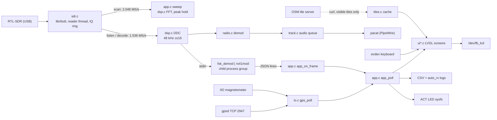

# System Architecture

Last updated: 2026-11-20 (version 0.6.0).

SondeChase is one C11 process on the CardputerZero. It reads the RTL-SDR in process, runs the RS41 decoder as
a child pipeline, merges GPS and magnetometer data, and draws every screen with LVGL 9.5 on the LCD framebuffer.
The core (`sc_core`) has no LVGL dependency and is unit-tested on any Linux host.

## Contents
- [Components](#components)
- [Diagram](#diagram)
- [Processes and threads](#processes-and-threads)
- [Receiver ownership and states](#receiver-ownership-and-states)
- [Data flows](#data-flows)
- [Peripherals](#peripherals)
- [Algorithms](#algorithms)
- [Map and tiles](#map-and-tiles)
- [Files written](#files-written)
- [Failure handling](#failure-handling)

## Components

| File | Lines | Responsibility |
|---|---|---|
| `src/sc.h` | 525 | The only public header: config, parsers, DSP, SDR, scan, app state and every module API |
| `src/main.c` | 90 | Entry point, signal handling, main loop, LVGL setup, hold-Esc quit |
| `src/app.c` | 615 | State machine (`ST_IDLE`, `ST_SCAN`, `ST_LISTEN`, `ST_DECODE`), receiver ownership, decoder pipeline, sweep, Scan hunt, frame handling, CSV and auto_rx logs |
| `src/base.c` | 346 | `sc_now`, config parser and defaults, line reader, child process groups, flat-JSON field extraction |
| `src/sdr.c` | 273 | `librtlsdr` loaded with `dlopen`, reader thread, IQ ring, tuner range table |
| `src/dsp.c` | 215 | FFT, decoder front end (DDC: rotation, half-band decimation, droop FIR), wide 192 kHz stream |
| `src/radio.c` | 174 | Audio demodulators for NFM, AM, USB, LSB, WFM |
| `src/io.c` | 380 | gpsd client (TPV and SKY), magnetometer heading, USB SDR presence, spectrum cells and peaks |
| `src/geo.c` | 202 | Geodesy, ISA, dew point, wind profile, sonde JSON parse, landing prediction |
| `src/track.c` | 310 | Flight history, burst detection, proximity beeper, PCM audio stream to `pacat`, frame LED, slippy-map maths |
| `src/tiles.c` | 290 | Tile lookup, `curl` downloads with cache cap and failure reasons, recolouring |
| `src/demo.c` | 139 | Simulated flight (`demo = 1`) through the same frame path |
| `src/keys.c` | 92 | Keyboard from evdev (`/dev/input/event*`), Sym symbol keys, held-arrow repeat |
| `src/ui.c` | 249 | UI state, overlays (frequency entry, burst alert, no SDR), LVGL draw callback, key dispatch (`ui_key`) |
| `src/ui_draw.c` | 220 | Drawing primitives (line, rectangle, label), top and nav bars, battery |
| `src/ui_track.c` | 215 | Track screen and compass |
| `src/ui_map.c` | 284 | Map screen, decoded tile cache, pan, zoom, follow, style |
| `src/ui_graph.c` | 142 | Skew-T and flight profile |
| `src/ui_radio.c` | 159 | Band overview, tuned spectrum, listening, decoding |
| `src/ui_info.c` | 154 | Info screens and compass calibration |
| `src/ui_priv.h` | 76 | Colours, shared UI state and prototypes for the UI files |
| `src/ui.h` | 16 | UI entry points used by `main.c` |
| `tools/render.c` | 209 | Headless build of the real UI for screenshots (`SC_RENDER`) |

The UI is one file per screen (see [code standards](./code-standards.md#file-size)).

## Diagram

## Processes and threads

| Unit | Kind | Notes |
|---|---|---|
| Main process | Single thread | Keys, `app_poll`, `lv_timer_handler`, sleep of 5 to 30 ms per loop. While scanning with the sweep running, the wait is capped at 10 ms |
| librtlsdr reader | Thread in `sdr.c` | Runs librtlsdr's async read and writes IQ bytes into a 4 MiB lock-free ring (about 1.4 s at 1.536 MS/s). Drops are counted, never block the reader |
| Decoder pipeline | `sh -c` child in its own process group | `fsk_demod --cs16 ... \| rs41mod --json ...`. Stdin is fed by the app; stdout is read line by line |
| Audio | `sh -c` child (`audio_cmd`, default `pacat`) | Receives 16 kHz S16_LE mono PCM: beeper tones and, on the Radio screen, the demodulated audio |
| Tile fetch | `sh -c` children (`tile_fetch_cmd`, `curl`) | At most `TF_JOBS` = 2 at a time |
| gpsd | Non-blocking TCP socket | Sends `?WATCH` JSON; reconnect attempted every 5 s |

The app sets itself as a child subreaper (`PR_SET_CHILD_SUBREAPER`). Process-group members that a shell leaves
behind are reaped by the app (`reap_group`) instead of becoming zombies under the launcher.

## Receiver ownership and states

The dongle is opened once per session and kept open (`app_t.rx`). The band sweep and the tuned receiver take turns
on it: the sweep runs at `SWEEP_RATE` (2.048 MS/s), listening and decoding at `DDC_RATE` (1.536 MS/s). Switching
job restarts only the USB stream at the other rate.

| State | Entered by | Receiver | Decoder | Audio and spectrum |
|---|---|---|---|---|
| `ST_IDLE` | initial state; `app_stop` (`X`) | none | no | none |
| `ST_SCAN` | `app_scan`, `app_hunt` (`S`) | sweep at 2.048 MS/s | no. A hunt switches to `ST_DECODE` for each peak it tries | band overview |
| `ST_LISTEN` | `app_listen`: tuning with arrow keys, startup without `freq_hz` | tuned at 1.536 MS/s | no | tuned spectrum and radio audio |
| `ST_DECODE` | `app_tune`: `Enter`, `F` + frequency, `R`, `freq_hz` at start-up | tuned at 1.536 MS/s | yes, `fsk_demod \| rs41mod` | spectrum while the Radio screen is shown |

- Start-up: with `freq_hz` set the app decodes that frequency. Without it the app opens on the Radio screen and
  listens at the middle of the scan band (403.000 MHz with the default range).
- Scan hunt (`app_hunt`): after two completed sweep passes, the strongest peak at least `HUNT_SNR_DB` (10 dB) above
  the floor is tried with the decoder for `HUNT_TRY_S` (10 s). An RS41 frame on it ends the hunt there. Otherwise the
  peak is skipped for `HUNT_SKIP_S` (120 s); up to `HUNT_SKIP_N` (16) peaks are remembered.
- Missing receiver: with `sdr_check = 1` the USB bus is scanned every 2 s (`sdr_present`). Without a receiver the
  UI shows the "No SDR device found" screen and nothing runs.

## Data flows

### Receive and decode

1. `sdr_open` loads `librtlsdr` (`rtlsdr_lib`, default `librtlsdr.so.0`), applies `ppm`, `gain`, `bias_tee`, and
   starts the reader thread.
2. `rx_poll` (in `app.c`) drains the ring in 64 KiB reads. For each read it:
   - runs `ddc_process_wide` (see [Algorithms](#algorithms)) and writes 48 kHz cs16 pairs to the decoder pipe with
     `proc_feed`. Writes the child cannot accept are dropped and counted (`wdrop`); no sample alignment is lost;
   - when the Radio screen is on (`radio_audio`), demodulates the tuned frequency with `radio_process` (or
     `radio_process_wfm` for WFM) and pushes the audio to the audio queue;
   - every 50 ms, while the Radio screen is shown, computes the live spectrum (5 FFTs, 1024 points).
3. `app_poll` reads the decoder's stdout with `lr_readline`. Lines that start with `{` go to `app_on_frame`.
   Other text is ignored.
4. `app_on_frame` calls `sonde_parse`:
   - return 1 (valid position): the sonde becomes the current sonde; known frequencies are updated; wind profile
     (if ascending), history, burst detection, landing prediction and the logs are updated;
   - return 2 (telemetry without a GPS solution, fewer than 4 satellites): stored as `nofix` only. It is not added
     to the track, history, prediction or logs;
   - return 0: ignored.
5. On a valid frame `app_on_frame` also plays the frame tick and blinks the LED when a Track or Map screen is on
   (`frame_cue`).

Frames from a new serial reset the wind profile, history, flight phase and burst alert.

### Scan sweep

`sweep_poll` takes `SWEEP_FRAMES` (5) FFTs per retune step, folds them into `spectrum_t` cells with peak hold, and
steps through the band. `spec_peaks` returns the peaks for the Radio screen and for the hunt. Known sondes
(`known_t`, up to 16 frequencies within 10 kHz) label their peaks with the serial.

### Position, heading and derived values

`app_poll` each loop:
- `gps_poll` reads gpsd. A fix is valid for 5 s after its last TPV report (`gps_ok`). SKY reports give satellites
  in view and used (`gps_sky`).
- `heading_update` picks the compass source in this order: GPS course when speed ≥ `cog_min_speed`, the magnetometer
  when found (read at 5 Hz), otherwise hold the last heading (`HDG_HOLD`).
- With a sonde and a valid GPS fix: ground distance, bearing, elevation angle and the relative bearing for the
  arrow. Landing point distance and bearing when a prediction exists.
- The proximity beeper (`prox_update`) and the telemetry tones use the ground distance.

### Radio audio

`radio.c` shifts the 48 kHz stream by −12 kHz so the tuned frequency sits at 0 Hz, filters the channel, demodulates,
and decimates to 16 kHz. Output goes to `audio_radio_push`, which mixes it with beeper tones in one `pacat` stream.

### Output

- Screens: a 200 ms LVGL timer (`tick_cb`) and every key press invalidate the root object. The single
  `LV_EVENT_DRAW_MAIN` callback (`draw_cb`) repaints the active screen from `app_t`, immediate-mode style. LVGL
  writes to the LCD framebuffer through `lv_linux_fbdev`; `fb_pick` (`base.c`) chooses it at start: `fb_dev`, then `$LV_LINUX_FBDEV_DEVICE`, then `/dev/fb_lcd`, then `/proc/fb`, then `/dev/fb0`.
- Logs: see [Files written](#files-written).
- Burst: `flight_update` returns 1 once, sets `burst_alert`, and plays three rising tones (880, 1320, 1760 Hz).

## Peripherals

| Peripheral | Interface | Access | Notes |
|---|---|---|---|
| RTL-SDR (RTL2832U) | USB, `librtlsdr` | `dlopen` at run time; `rtl_dev` index | Matches VID:PID `0bda:2838` or `0bda:2832` for the presence check. Tested: RTL-SDR Blog V4 (R828D tuner) |
| GPS | gpsd, TCP `127.0.0.1:2947` (`gpsd_host`, `gpsd_port`) | Non-blocking socket, JSON `TPV` and `SKY` | `gpsd_port = 0` disables it. A USB GPS can be plugged in while the app runs; gpsd picks it up |
| Magnetometer | IIO sysfs `/sys/bus/iio/devices/iio:deviceN/in_magn_{x,y}_raw` | Read at 5 Hz | `mag_enable`, `mag_off_x/y`, `mag_rot_deg`, `mag_flip_y`, `declination`. Not tilt-compensated |
| ACT LED | sysfs `led_path` (default `/sys/class/leds/ACT/brightness`) | One-byte write per blink | Writable by the `input` group. The first blink drops the kernel's `actpwr` trigger until reboot |
| Audio | `pacat` via `audio_cmd` (PipeWire) | Child stdin, 16 kHz S16_LE mono | `audio_enable`. Without PipeWire, `aplay` can be used through `audio_cmd` |
| Display | `/dev/fb_lcd` (found by `fb_pick`), `fb_dev` | LVGL `lv_linux_fbdev` | 320×170 |
| Keyboard | evdev, `/dev/input/event*` | Non-blocking read, device grabbed | `kbd_dev` sets the device; empty auto-detects the first device with Q, Enter and 1 keys |
| Network (tiles) | HTTPS via `curl` | Child process | Only when `tile_online = 1` |

Battery: read from sysfs every 10 s for the top bar.

## Algorithms

### Band sweep

- 2.048 MS/s; the central 80 % of each 1024-point FFT is kept (2 kHz bins), so each retune step covers
  1.6384 MHz. Four steps cover the 400–406 MHz default band.
- After each retune: 15 ms of IQ are discarded, plus one 16 KiB USB transfer. Then 5 FFT frames are averaged.
- The tuner's DC offset and LO leakage create false peaks within 50 kHz of each tuning centre. Each step ignores
  that zone. Odd passes are shifted by half a step so the neighbouring step measures it. The tuned view interpolates
  across it.
- Peak hold: each cell keeps its value against the previous pass decayed by 3 dB, so a sonde's peak stays steady
  between frames and a signal that stops fades within seconds.
- Measured on the device: a full 400–406 MHz pass about every 0.25 s (see [deployment guide](./deployment-guide.md#device-checks)).

### Decoder front end (`dsp.c`)

Port of `rtl_fm -M raw -F9 -s 48000` (rtl-sdr 2.0.2 chain):

1. The dongle is tuned to `f − 12 kHz + 384 kHz` (`DDC_RATE / 4` above the wanted centre), so the RS41 sits at
   +12 kHz in the stream and the DC spike is away from it.
2. A 90° rotation (phase steps 0 to 3) brings the band to 0 Hz.
3. Five binomial half-band stages decimate by 2 each (32 in total), giving 48 kHz.
4. A 9-tap FIR compensates the droop.
5. The 48 kHz complex int16 stream goes to `fsk_demod --cs16`.

The same routine also gives the 192 kHz stream after the third halving (`DDC_WIDE_RATE`) for WFM.

### Radio demodulation (`radio.c`)

| Mode | Input | Method | Output |
|---|---|---|---|
| NFM | 48 kHz | Phase-difference discriminator on a 63-tap channel filter; noise squelch on the mean square over 20 ms, threshold per channel width; closed squelch is a murmur | 16 kHz |
| AM | 48 kHz | Envelope, gain follows the carrier level | 16 kHz |
| USB / LSB | 48 kHz | Complex filter keeps one sideband; real part with AGC | 16 kHz |
| WFM | 192 kHz | Same discriminator (±75 kHz), 50 µs de-emphasis, 10 kHz low-pass, decimate by 12 | 16 kHz |

Channel widths: NFM 16 / 25 / 6 / 12 kHz (16 kHz default), AM 6 / 10 kHz, SSB 2.4 / 3 kHz, WFM 180 kHz (display only;
the 192 kHz stream is the channel).

### Sonde JSON and position validity (`geo.c`)

`sonde_parse` reads the flat JSON that `rs41mod` prints (`lat`, `lon`, `alt`, `id`, `frame`, `sats`, `vel_v`,
`vel_h`, `heading`, `temp`, `humidity`, `pressure`, `batt`, `bt`, `datetime`, `subtype`). Before a GPS solution a
sonde reports `sats` below 4 and a meaningless position, so those frames return 2.

If a sonde reports no pressure, `pres_est` is set and the pressure is the ISA value for its altitude (shown with a
`~` prefix in the UI).

### Wind profile

Ascending frames (`vel_v > 1 m/s`) add `vel_h` and `heading` to 250 m bins up to 40 km (`wind_add`). Prediction
uses the bin for each layer and falls back to the current horizontal velocity for unobserved layers.

### Landing prediction (`predict_landing`)

- Ground level: `ground_alt` from the config (`< -900` means "use this device's GPS altitude"; the shipped config
  leaves it unset).
- Ascending (`vv > 0.5 m/s`): climbs to `burst_alt` in 100 m layers at the current rate, wind-drifting, then descends
  at `descent_v0` (sea-level equivalent).
- Descending (`vv < −0.5 m/s`): sea-level equivalent `v_sl = |vv| / sqrt(ρ0 / ρ(h))`, from the measured vertical speed.
- Descent in 100 m layers: `dt = Δh / (v_sl · sqrt(ρ0 / ρ(h_mid)))`, with ISA density `ρ(h)`. Horizontal drift is
  `wind · dt`, summed and converted to a destination with the geodesic helper.
- Floating or on the ground (`|vv| ≤ 0.5`): no prediction.
- The vertical speed used is `vv_s`, smoothed as `0.7 · old + 0.3 · new`.

Limits: during ascent the result depends on the assumed `burst_alt`, and winds above the current altitude are not
used (see [roadmap](./project-roadmap.md#known-gaps)).

### Burst detection (`flight_update`)

Phases: unknown, ascent (`vel_v > 1 m/s`), descent, landed. Burst is raised when `vel_v < −3 m/s` on three
consecutive frames, after an ascent was seen, and the altitude is above 1000 m. A descent seen without a prior
ascent (receiver started late) sets the phase but raises no alert. Landed means `|vel_v| < 0.5 m/s` for five frames.

### Proximity beeper (`prox_*`)

Ground distance `d` from the device to the sonde (or to its last fix when the signal is lost).

- On when `d ≤ prox_radius_m` (10 km), off when `d > radius + prox_hyst_m` (10.5 km).
- Interval `T = 0.12 + 1.88 · (d / 10 km)^0.6` s, capped at 10 km. Each beep is 60 ms.
- Volume `V = 1 − 0.35 · log10(d / 100 m)` clamped to 0.3–1.0.
- Pitch: 2200 Hz while telemetry is fresh (`stale_s`), 1100 Hz when stale.
- Muted by `M`. Silent while the position is unknown.

### Frame cue

On the Track and Map screens each valid frame plays a 30 ms 1500 Hz tick (unless muted with `M`) and blinks the ACT
LED for 80 ms. The LED returns to its resting state; the tick is not played when muted, the LED still blinks.

### Skew-T log-P (`ui_graph.c`)

Pressure axis `y ∝ ln(1050 / p)` from 1050 to 100 hPa. Isotherms are skewed 45°, dry adiabats follow
`T = θ · (p / 1000)^0.2857`. Dew point uses the Magnus formula (`dewpoint`, a = 17.62, b = 243.12 °C).
Moist adiabats and mixing-ratio lines are not drawn.

## Map and tiles

Tile lookup order (`tf_find`, then `tf_request` for a download):

1. Preloaded pack in `tile_dir` (`z/x/y.png`, already in UI colours, see [deployment guide](./deployment-guide.md#map-tiles)).
2. Download cache in `tile_cache_dir` (default `<data_dir>/tiles`, `data_dir` = `$HOME/sondechase`), original server PNGs, recoloured
   when loaded into RAM.
3. Missing and `tile_online = 1`: download only the tiles the Map screen shows, at most two at a time, with a
   User-Agent from `tile_user_agent`. A failed tile is not retried for 30 s.

Rules:
- Nothing is prefetched. Bulk downloading for offline use is not implemented.
- The cache is capped by `tile_cache_mb` (default 1000). Above the cap the oldest downloaded tiles are removed.
- Failure reasons (`TF_WHY_*`) set the Map status text:

| Status | Cause |
|---|---|
| `Loading map` | Download in progress |
| `No network: stored map only` | Network or HTTP error |
| `No map stored for this area` | `tile_online = 0` and no tile on disk |
| `Map server blocked by DNS` | Name resolves only to `127.0.0.1`, `::1` or `0.0.0.0` (a DNS filter) |
| `Map server name not found (DNS)` | Name does not resolve |

Recolouring (`tile_recolor`) gives two styles from the same tiles. `V` toggles them; `map_simple` sets the start-up
style:
- **simple** (default): only water and roads. Main roads become bright, minor roads dim, labels, buildings and land
  use go to the background.
- **detailed**: the most frequent colour is treated as background; roads and labels become bright strokes on dark.

Map centre when neither this device nor a sonde has a position: `map_lat` / `map_lon` (default Hanoi,
21.0285 / 105.8542).

## Files written

| Path | When | Format |
|---|---|---|
| `<data_dir>/sondechase.csv` (default `$HOME/sondechase`) | Every valid sonde frame | One header per file, then `unix,id,frame,lat,lon,alt,vel_v,vel_h,heading,freq_hz,own_lat,own_lon,pred_lat,pred_lon` |
| `<data_dir>/log/YYYYMMDD-HHMMSS_<serial>_RS41_<MHz>_sonde.log` | Every valid sonde frame | radiosonde_auto_rx sonde-log columns (`timestamp,serial,frame,lat,lon,alt,...,aux_data`). Time is the sonde's own GPS time in UTC; the system clock is used only when the sonde sends none. SNR, frequency error and burst timer are written as `-1` where not measured |
| `<data_dir>/tiles/` | Map downloads, kept for offline use | `z/x/y.png` |

The app has no RTC; the auto_rx-format file name and timestamps therefore come from the sonde's GPS, not from the clock.

## Failure handling

| Event | Behaviour |
|---|---|
| No RTL2832U on USB | Blocking "No SDR device found" screen; rechecked every 2 s |
| Dongle opens fail (busy, librtlsdr missing) | Reason on the status line; the app retries |
| Dongle unplugged while streaming | Receiver state reset; restart after 2 s |
| Decoder exits | Pipeline stopped and restarted after 3 s (`decoder exited, restarting`) |
| Decoder pipe full | Chunks dropped and counted; no misalignment |
| gpsd unavailable | Reconnect every 5 s; the top bar shows `No GPS` or `GPS lost` |
| Map tile download fails | Status text on the Map; retry after 30 s |
| Burst alert | Overlay on every screen; `Enter` opens Map, `Esc` dismisses |
| Hold `Esc` for 3 s | Quit back to the launcher |
